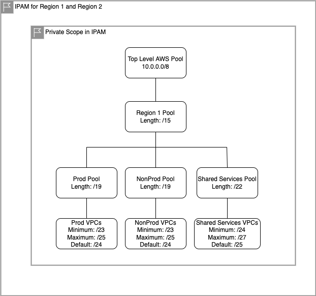
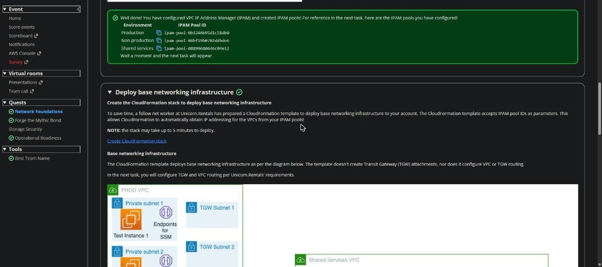
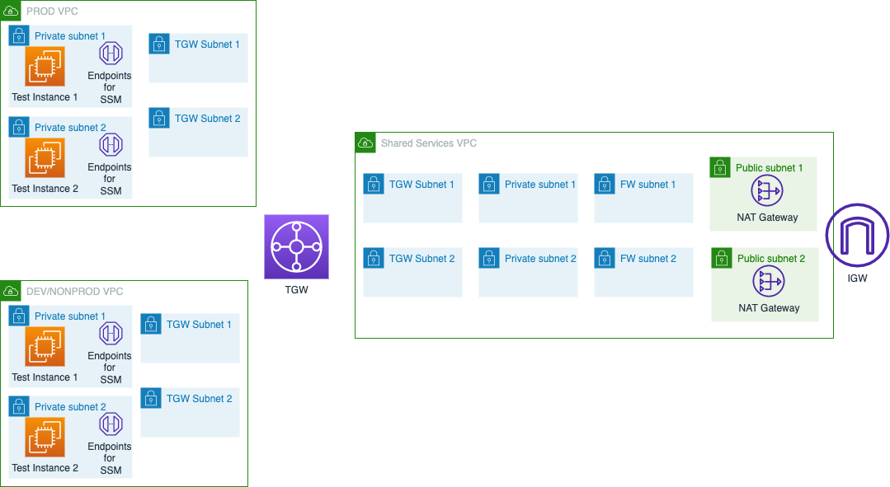
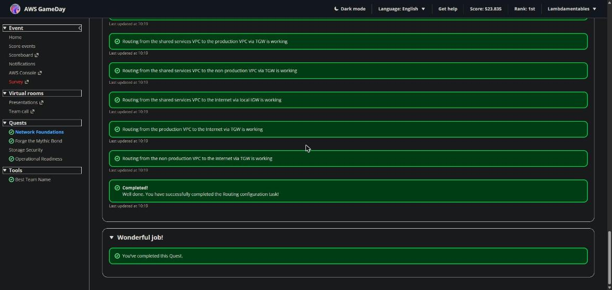
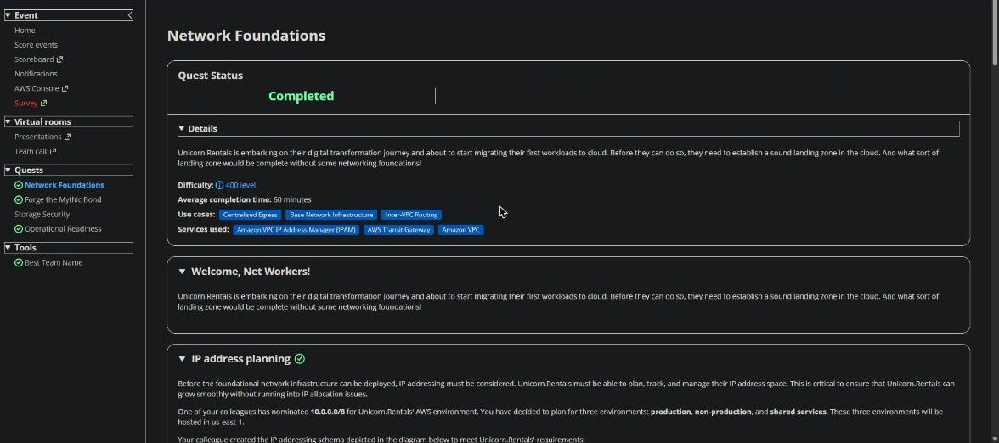
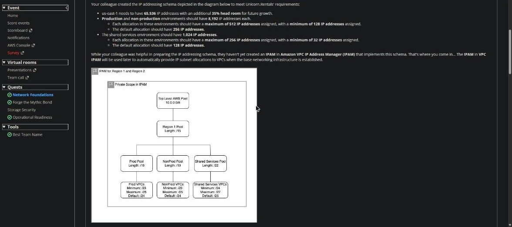
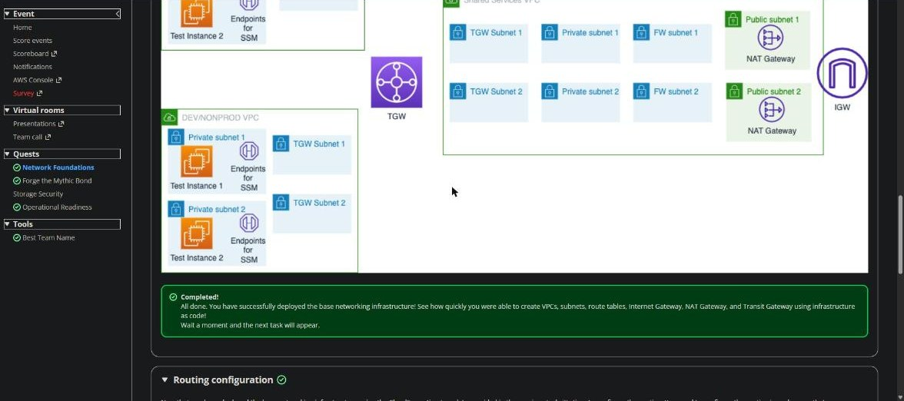
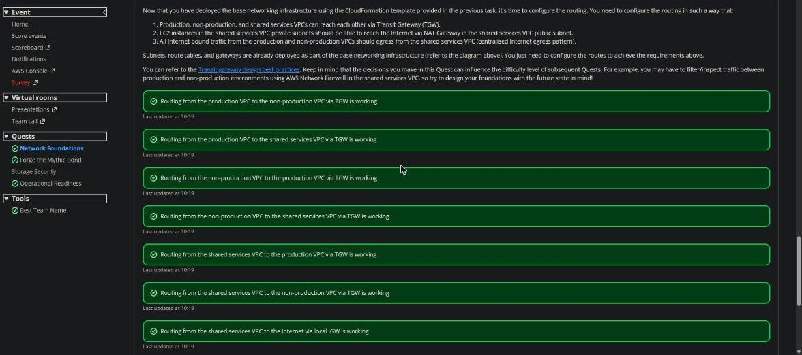

<div align="center">

# Quest 1 - Network Foundations (IPAM, CloudFormation y Transit Gateway)


**Nombre en el GameDay:** *Network Foundations* · 3 tareas · nivel 400 · us-east-1 · 149.910 puntos


</div>

## De qué va

Unicorn.Rentals va a migrar a AWS y necesita los cimientos de red de su *landing zone*. Hay que:

1. Diseñar y crear el plan de direcciones IP con **VPC IPAM**: un pool por región y por entorno.
2. Desplegar la red base (3 VPC, subredes, NAT, IGW y Transit Gateway) con una **plantilla de CloudFormation** que pide IPs a IPAM.
3. Configurar el **enrutamiento** del Transit Gateway y de las VPC: todas las VPC se ven entre sí y Producción y Desarrollo salen a Internet por la VPC de servicios compartidos (**salida centralizada**).

## Arquitectura final

```text
                 IPAM  10.0.0.0/8 (top-level)
                  └── us-east-1  10.0.0.0/15
                       ├── production       10.0.0.0/19  ──► VPC PROD   10.0.0.0/23
                       ├── non-production   10.0.32.0/19 ──► VPC DEV    10.0.32.0/23
                       └── shared-services  10.0.64.0/22 ──► VPC SHARED 10.0.64.0/24

 VPC PROD ──┐ (spoke-rt)                         (shared-rt) ┌── VPC SHARED-SERVICES
 VPC DEV  ──┴──►  TRANSIT GATEWAY  ── 0.0.0.0/0 ─────────────┘     TGW subnet ─► NAT (subred pública) ─► IGW ─► Internet
                                                                  privadas  ─► NAT ─► IGW
```

---

## Tarea 1 - Plan de direcciones con IPAM

### Qué pide

Crear un IPAM que implemente el esquema del compañero: 10.0.0.0/8 en total, us-east-1 con 65.536 IP + 35 %, Producción y No producción con 8.192 cada uno y Servicios compartidos con 1.024. Cada entorno tiene un tamaño mínimo, máximo y por defecto para las asignaciones. Se valida escribiendo el **ID del pool top-level** y después el del **pool regional**.

### Cómo pensarlo

Todo es pasar **número de IPs a longitud de máscara**: IPs = 2^(32 − máscara). Si el número no es potencia de 2, se redondea a la **siguiente**:

| Requisito | Cuenta | Potencia de 2 | Máscara |
|:--|:--|:-:|:-:|
| us-east-1: 65.536 + 35 % | 65.536 × 1,35 = 88.474 | 131.072 = 2^17 | **/15** |
| Producción / No producción | 8.192 | 2^13 | **/19** |
| Servicios compartidos | 1.024 | 2^10 | **/22** |
| Asignación 512 / 256 / 128 / 32 IP | — | 2^9 / 2^8 / 2^7 / 2^5 | /23 · /24 · /25 · /27 |

La jerarquía de pools es **top-level → regional (con *locale*) → un pool por entorno**. El *locale* es la región en la que se pueden usar las IPs del pool. Solo los pools con locale pueden dar IPs a una VPC.

**La trampa de los nombres:** en IPAM, *minimum netmask length* es la máscara **más corta**, es decir, el bloque **más grande**. Por eso "máximo 512 IP" se pone en `allocation-min-netmask-length = 23` y "mínimo 128 IP" en `allocation-max-netmask-length = 25`.

| Pool | Locale | CIDR | Asignación mín. / por defecto / máx. (máscara) |
|:--|:-:|:--|:--|
| top-level | — | 10.0.0.0/8 | — |
| us-east-1 | us-east-1 | 10.0.0.0/15 | — |
| production | us-east-1 | 10.0.0.0/19 | min 23 · default 24 · max 25 |
| non-production | us-east-1 | 10.0.32.0/19 | min 23 · default 24 · max 25 |
| shared-services | us-east-1 | 10.0.64.0/22 | min 24 · default 25 · max 27 |

El diagrama del enunciado (*IPAM Hierarchy Diagram*) da solo las **longitudes**, no los CIDR concretos:

<div align="center">



</div>

> Durante el GameDay el diagrama no se llegó a ver, y los tamaños se dedujeron del texto. Coinciden con el diagrama. Los CIDR concretos (bloques seguidos desde 10.0.0.0) los elegimos nosotros, y el validador los aceptó: lo que comprueba son los **tamaños** y las **reglas**.

### Paso a paso en la consola

1. **VPC IP Address Manager** → **IPAMs** → **Create IPAM** → **Operating regions:** `us-east-1` → **Create**.
2. Entrar en el IPAM → **Pools** → **Create pool**:
   - **Scope:** el *private scope* por defecto → **Name:** `top-level` → **Source:** *IPAM scope* → **Locale:** *None*.
   - **Provision CIDRs:** `10.0.0.0/8` → **Create pool**.
3. **Create pool** → **Name:** `us-east-1` → **Source:** *IPAM pool* → `top-level` → **Locale:** `us-east-1` → **CIDR:** `10.0.0.0/15`.
4. **Create pool** para cada entorno, con **Source** = el pool `us-east-1` y **Locale** = `us-east-1`:
   - `production`: CIDR `10.0.0.0/19` → **Configure this pool's allocation rule settings:** *Minimum netmask* `/23`, *Default* `/24`, *Maximum* `/25`.
   - `non-production`: CIDR `10.0.32.0/19`, con las mismas reglas.
   - `shared-services`: CIDR `10.0.64.0/22` → mínimo `/24`, por defecto `/25`, máximo `/27`.
5. Esperar a que todos los CIDR estén **Provisioned**, copiar los `ipam-pool-...` del top-level y del regional y pegarlos en el GameDay.

### Con la CLI

Bloque *TAREA 1* de [`scripts/comandos.sh`](scripts/comandos.sh): `create-ipam`, `create-ipam-pool` y `provision-ipam-pool-cidr`, con esperas entre cada paso.

### Comprobación

`describe-ipam-pools` muestra los 5 pools con sus reglas, y `get-ipam-pool-cidrs` da `provisioned` en todos. El GameDay respondió *"Top level pool configuration completed"* y después *"Well done! You have configured VPC IP Address Manager"*, con los IDs de los tres pools de entorno para la tarea siguiente:



---

## Tarea 2 - Red base con CloudFormation

### Qué pide

Lanzar la plantilla del reto pasándole los IDs de los tres pools de entorno.

### Cómo pensarlo

- La plantilla crea VPC con `Ipv4IpamPoolId` en lugar de un `CidrBlock` fijo: **IPAM asigna el CIDR** con la longitud por defecto del pool (/24 o /25), o con la que pida la plantilla. Por eso PROD y DEV salieron con /23 y SHARED con /24.
- Crea roles IAM con **nombre fijo**, así que necesita `CAPABILITY_NAMED_IAM`. Por la misma razón, **dos stacks a la vez chocarían**. Si se lanza por la CLI, no hay que pulsar también *Create stack* en la consola.
- Los parámetros de nombres de VPC y AMI vienen marcados *DO NOT MODIFY*: se dejan los valores por defecto.

### Paso a paso en la consola

1. Pulsar el enlace **Create CloudFormation stack** del reto. Abre *Quick create stack* con la plantilla cargada.
2. **Stack name:** cualquiera, por ejemplo `network-foundations`.
3. **Production / Non-production / Shared services IPAM pool ID:** los tres `ipam-pool-...` de la tarea anterior.
4. Marcar *I acknowledge that AWS CloudFormation might create IAM resources with custom names* → **Create stack**.
5. Esperar a **CREATE_COMPLETE** (unos 5 minutos, por los NAT Gateways y las EC2).

### Con la CLI

Bloque *TAREA 2* de [`scripts/comandos.sh`](scripts/comandos.sh). La URL de la plantilla es el parámetro `templateURL=` del enlace de la consola. `get-template-summary` enseña los parámetros antes de lanzarla.

### Qué despliega

Diagrama del enunciado:

<div align="center">



</div>

| VPC | CIDR (de IPAM) | Subredes (2 AZ) | Extra |
|:--|:--|:--|:--|
| PROD | 10.0.0.0/23 | Private ×2 (/25), TGW ×2 (/28) | 2 EC2 de prueba, endpoints de SSM |
| DEV | 10.0.32.0/23 | Private ×2 (/25), TGW ×2 (/28) | 2 EC2 de prueba, endpoints de SSM |
| SHARED-SERVICES | 10.0.64.0/24 | Private, Public, TGW y FW, ×2 cada una (/28) | IGW, 2 NAT Gateway (uno por AZ), 2 EC2 |
| — | — | — | 1 Transit Gateway **sin attachments** y con la asociación y propagación por defecto **desactivadas** |

### Comprobación

El GameDay revisa cada pocos minutos y marca la tarea completada. La primera vez salió *"haven't yet deployed"* porque comprobó a las 10:13 y el stack terminó a las 10:13:43. Con esperar a la siguiente comprobación bastó.

---

## Tarea 3 - Enrutamiento con salida centralizada

### Qué pide

Que las 3 VPC se comuniquen por el TGW, que las privadas de SHARED salgan por su NAT, y que PROD y DEV salgan a Internet **a través de** SHARED. Además, hay que dejarlo preparado para meter **Network Firewall** entre Producción y Desarrollo más adelante.

### Cómo pensarlo

**Reconocimiento:** el TGW tiene `DefaultRouteTableAssociation` y `DefaultRouteTablePropagation` en `disable`, así que no hay ninguna tabla de rutas del TGW. PROD y DEV solo tienen su tabla principal, con la ruta `local`. SHARED tiene 8 tablas (Private, Public, TGW y FW, ×2), todas solo con `local`.

En un Transit Gateway hay que tener claros dos conceptos:

| Concepto | Qué decide |
|:--|:--|
| **Asociación** (una tabla por attachment) | Con qué tabla se busca el destino del tráfico que **entra** al TGW por ese attachment |
| **Propagación** (a varias tablas) | En qué tablas aparece **el CIDR de esa VPC** como destino |

El diseño elegido son **dos tablas** (patrón *hub and spoke*), que es el que recomienda AWS para inspección centralizada:

| Tabla del TGW | Asociada a | Rutas |
|:--|:--|:--|
| `spoke-rt` | PROD, DEV | `0.0.0.0/0` → attachment de SHARED (estática) + propagadas de PROD, DEV y SHARED |
| `shared-rt` | SHARED | propagadas de PROD y DEV (para la vuelta) |

¿Por qué no una sola tabla? Porque así el tráfico de los spokes hacia Internet tiene una ruta estática hacia SHARED. Cuando haya que inspeccionar PROD ↔ DEV, basta con **quitar las propagaciones de PROD y DEV de `spoke-rt`**: todo caerá en el `0.0.0.0/0` hacia SHARED, donde estará el firewall. El attachment de SHARED se crea con **appliance mode** para que la ida y la vuelta de un flujo pasen por la misma AZ, porque un firewall con estado lo necesita.

Rutas dentro de las VPC:

| Tabla de la VPC | Destino → siguiente salto | Por qué |
|:--|:--|:--|
| PROD y DEV (principal) | `0.0.0.0/0` → TGW | Todo lo que no es local, incluido el resto de VPC e Internet |
| SHARED Private 1 / 2 | `0.0.0.0/0` → NAT de su AZ · `10.0.0.0/8` → TGW | Internet por su NAT y el resto de la red por el TGW |
| SHARED TGW subnet 1 / 2 | `0.0.0.0/0` → NAT de su AZ | Lo que llega de los spokes hacia Internet. Aquí irá el firewall en el futuro |
| SHARED Public 1 / 2 | `0.0.0.0/0` → IGW · `10.0.0.0/8` → TGW | La respuesta que vuelve al NAT tiene que regresar a PROD o DEV |

> La ruta `10.0.0.0/8 → TGW` en las **públicas** es la que más se olvida. Sin ella, el NAT recibe la respuesta de Internet pero no sabe devolverla a 10.0.0.x.

### Paso a paso en la consola

1. **VPC** → **Transit gateway attachments** → **Create**, tres veces, una por VPC:
   - **Transit gateway:** el del stack → **Attachment type:** *VPC* → **VPC:** PROD → **Subnet IDs:** las dos *PROD TGW Subnet*.
   - Lo mismo para DEV con las *DEV TGW Subnet*.
   - SHARED con las *SHARED-SERVICES TGW Subnet* y además marcar **Appliance Mode support**.
2. Esperar a que los tres estén **Available** (2-5 minutos).
3. **Transit gateway route tables** → **Create**: `spoke-rt` y `shared-rt`.
4. `spoke-rt` → **Associations** → asociar PROD y DEV → **Propagations** → propagar PROD, DEV y SHARED → **Routes** → **Create static route** `0.0.0.0/0` → attachment de SHARED.
5. `shared-rt` → **Associations** → SHARED → **Propagations** → PROD y DEV.
6. **Route tables** de las VPC → añadir las rutas de la tabla de arriba. Hay que fijarse en usar la **NAT de la misma AZ** que la subred.

### Con la CLI

Bloque *TAREA 3* de [`scripts/comandos.sh`](scripts/comandos.sh): reconocimiento, attachments, tablas del TGW y las 12 rutas de las VPC.

### Comprobación

```text
--- spoke-rt
0.0.0.0/0     static      tgw-attach-...(SHARED)
10.0.0.0/23   propagated  tgw-attach-...(PROD)
10.0.32.0/23  propagated  tgw-attach-...(DEV)
10.0.64.0/24  propagated  tgw-attach-...(SHARED)
--- shared-rt
10.0.0.0/23   propagated  tgw-attach-...(PROD)
10.0.32.0/23  propagated  tgw-attach-...(DEV)
```

El validador revisa cada 2 minutos. A las 10:17 todo seguía en rojo porque los attachments estaban en `pending`; a las 10:19 estaban los 9 caminos en verde:



---

## Cómo lo resolvimos

Toda la quest se hizo **por la AWS CLI desde PowerShell** (Windows), comprobando cada resultado antes de seguir.

1. **Credenciales:** las del portal (*AWS Console → Command line access*) se guardaron en un perfil `jam` con `aws configure set`, porque las variables de entorno no se mantienen entre comandos. `sts get-caller-identity` confirmó el rol `WSParticipantRole/Participant`.
2. **IPAM (≈10:00):**
   - Primero se creó el IPAM, que no depende de los CIDR.
   - Como el diagrama no se veía, se calcularon los tamaños a partir del texto (tabla de arriba) y se crearon los 5 pools con un script que espera entre pasos.
   - El primer envío del ID regional falló por un espacio pegado delante.
3. **Stack (10:08-10:13):**
   - Con la URL de la plantilla del enlace del reto, `get-template-summary` enseñó los parámetros y que hacía falta `CAPABILITY_NAMED_IAM`. Se lanzó por CLI.
   - Hubo que avisar de **no** pulsar también *Create stack* en la consola, porque se habría duplicado.
   - El validador comprobó 40 segundos antes de que terminara y hubo que esperar a la siguiente pasada.
4. **Rutas (10:14-10:19):**
   - Antes de tocar nada se leyó todo: opciones del TGW, subredes con nombre, tablas de rutas y en qué AZ estaba cada NAT.
   - Con eso se decidió el diseño de dos tablas pensando en el futuro Network Firewall.
   - Un único script creó los attachments, esperó a `available`, creó las tablas del TGW y las 12 rutas.
   - La evaluación de las 10:17 salió en rojo (los attachments aún en `pending`) y la de las 10:19, toda en verde.

## Errores típicos

| Síntoma | Causa | Solución |
|:--|:--|:--|
| *"The specified IPAM pool ID is not valid"* con un ID correcto | Un **espacio** delante del valor al pegarlo | Borrar y escribir el ID sin espacios |
| No deja provisionar el CIDR de un pool hijo | El padre aún no tiene su CIDR en `provisioned` | Esperar entre pasos |
| Las reglas de asignación salen al revés | Confundir *min/max netmask* con *min/max IPs* | min netmask = bloque más grande |
| El stack falla por recursos IAM duplicados | Lanzado dos veces (CLI y consola) | Lanzarlo una sola vez |
| *"haven't yet deployed"* con el stack ya creado | El validador comprobó antes de que terminara | Esperar a la siguiente comprobación |
| Todos los caminos en *"not working"* justo después de configurar | Los attachments estaban en `pending` en esa comprobación | Esperar a `available` y a la siguiente pasada |
| Los spokes no salen a Internet pero SHARED sí | Falta `10.0.0.0/8 → TGW` en las tablas **públicas** (vuelta del NAT) | Añadir esa ruta |
| No funciona nada entre VPC | Attachment sin **asociar** a ninguna tabla del TGW | Asociación + propagación |
| PowerShell: `'$var' is not a valid ARN` | Variables sin comillas en `Key=$var,...` | Poner el argumento entre comillas dobles |

## Capturas del GameDay

La página de la quest entera, de arriba abajo, tal como quedó al terminar:

<details>
<summary>Ver las 6 capturas</summary>











</details>

## Preguntas de repaso

<details>
<summary>¿Qué es un scope, un pool y un locale en VPC IPAM?</summary>

Un **scope** es el contenedor de más alto nivel: hay uno privado y uno público por defecto, y cada uno es un espacio de IPs independiente. Un **pool** es un rango de CIDR que se puede dividir en pools hijos o asignar a recursos. El **locale** es la región en la que se pueden usar las IPs de un pool: solo un pool con locale puede dar CIDR a una VPC de esa región.
</details>

<details>
<summary>¿Qué controlan allocation-min/max/default-netmask-length?</summary>

El tamaño de lo que se puede pedir al pool. `min` es la máscara más corta permitida, es decir, el bloque **más grande** (/23 = 512 IP). `max` es la máscara más larga, el bloque **más pequeño** (/25 = 128 IP). `default` es la que se usa si la VPC no pide un tamaño concreto.
</details>

<details>
<summary>¿Cuántas IPs da un /15 y por qué no vale un /16 para 65.536 + 35 %?</summary>

Un /15 tiene 2^17 = 131.072 IPs. Un /16 tiene exactamente 65.536, así que no cabe el 35 % extra (88.474 en total). Los CIDR solo crecen en potencias de 2, y la siguiente por encima de 88.474 es 131.072.
</details>

<details>
<summary>¿Qué diferencia hay entre asociación y propagación en una tabla del Transit Gateway?</summary>

La **asociación** dice qué tabla se consulta para el tráfico que entra por un attachment, y cada attachment tiene una sola. La **propagación** hace que el CIDR de un attachment aparezca automáticamente como ruta en una o varias tablas. Con las dos opciones por defecto desactivadas, como en este reto, hay que configurarlo todo a mano.
</details>

<details>
<summary>¿Qué es el appliance mode de un attachment y cuándo hace falta?</summary>

Hace que el TGW mande **los dos sentidos de un flujo por la misma AZ** del attachment. Hace falta en la VPC donde hay un appliance con estado, como Network Firewall o un firewall de terceros. Sin él, la ida puede ir por la AZ a y la vuelta por la b, y el firewall descarta la respuesta porque no ha visto la conexión.
</details>

<details>
<summary>¿Por qué la salida a Internet centralizada necesita una ruta al TGW en las subredes públicas de la VPC de egress?</summary>

Porque la respuesta de Internet llega al **NAT Gateway**, que está en la subred pública. El NAT traduce la dirección de destino a la IP privada original (10.0.0.x o 10.0.32.x) y la manda según la tabla de **su** subred. Sin `10.0.0.0/8 → TGW`, el paquete no tiene a dónde ir.
</details>

<details>
<summary>¿Cómo se metería AWS Network Firewall entre Producción y Desarrollo con este diseño?</summary>

1. Crear el firewall en las subredes **FW** de SHARED.
2. En las tablas **TGW subnet** de SHARED, cambiar `0.0.0.0/0` (y añadir `10.0.0.0/8`) para que apunten al **endpoint del firewall** de su AZ.
3. En las tablas **FW**, poner `0.0.0.0/0 → NAT` y `10.0.0.0/8 → TGW`.
4. En `spoke-rt`, quitar las propagaciones de PROD y DEV, para que el tráfico entre ellas caiga en `0.0.0.0/0 → SHARED`.

El appliance mode ya está activado.
</details>

## Contenido

| Ruta | Descripción |
|:--|:--|
| [`enunciado.md`](enunciado.md) | Enunciado de las 3 tareas |
| [`scripts/comandos.sh`](scripts/comandos.sh) | Solución por CLI: IPAM, stack y enrutamiento |
| [`capturas/`](capturas) | Diagramas del enunciado (IPAM y red base) y la página de la quest en el GameDay, entera |

---

[Volver al índice del GameDay](../README.md)
