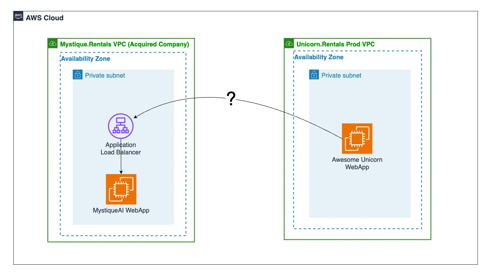
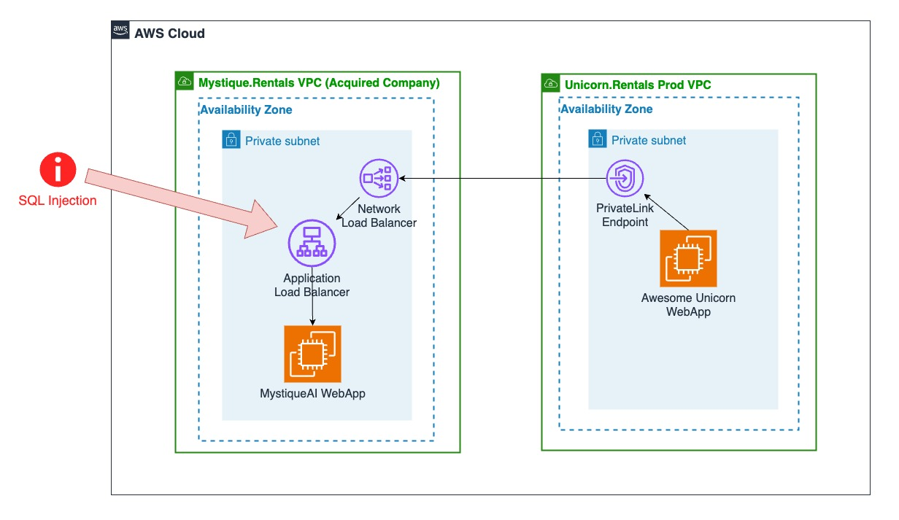
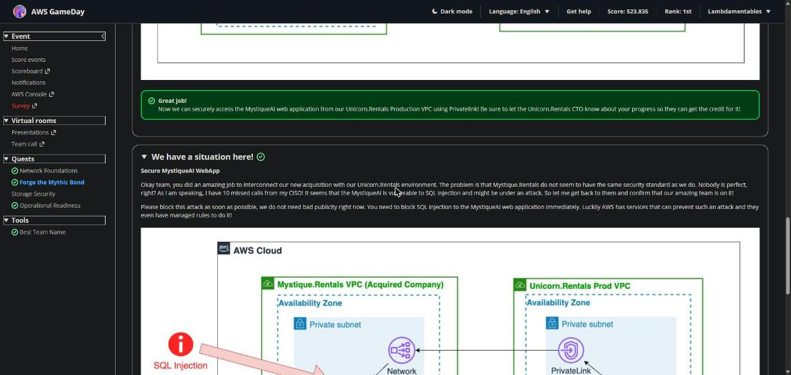
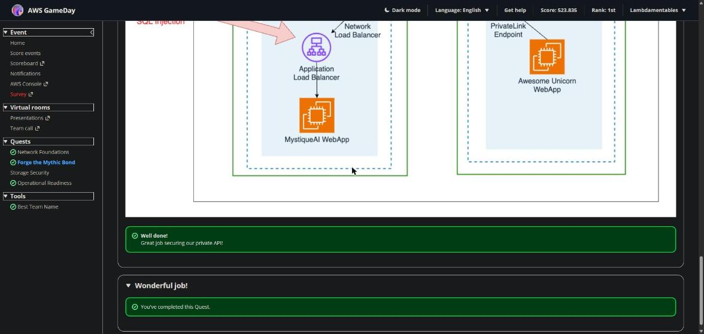
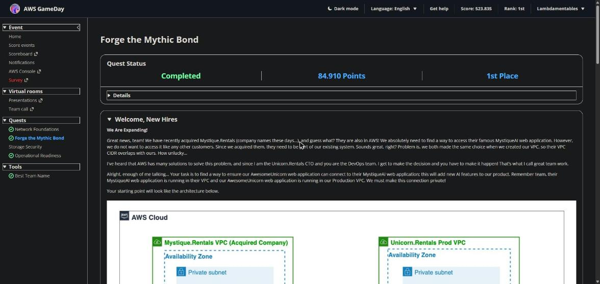
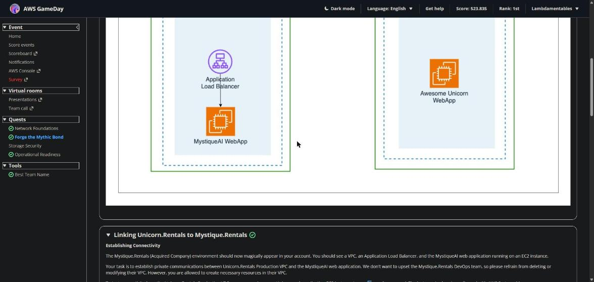
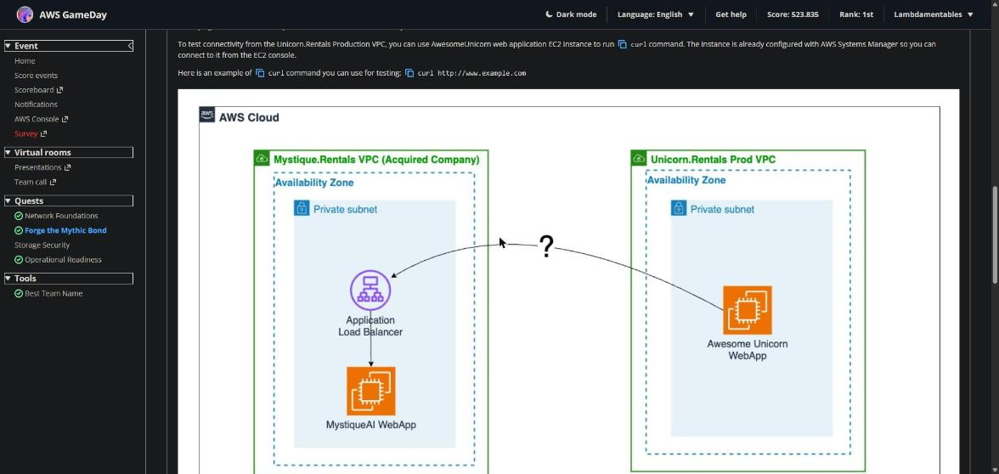

<div align="center">

# Quest 2 - Forge the Mythic Bond (PrivateLink y AWS WAF)


**Nombre en el GameDay:** *Forge the Mythic Bond* · 2 tareas · us-east-1 · 84.910 puntos


</div>

## De qué va

Unicorn.Rentals compra Mystique.Rentals. La aplicación AwesomeUnicorn (VPC de Producción) tiene que llamar **en privado** a MystiqueAI (VPC de Mystique), pero **las dos VPC usan 10.0.0.0/23**. Después aparece un ataque de **inyección SQL** contra MystiqueAI que hay que bloquear.

1. Conectar dos VPC **con CIDR solapados** sin modificar la de Mystique: **PrivateLink**.
2. Bloquear la inyección SQL con **AWS WAF** y su regla gestionada.

## Arquitectura

Punto de partida y solución esperada, según los diagramas del enunciado:

| Tarea 1: ¿cómo se conectan? | Tarea 2: la solución con PrivateLink, y el ataque |
|:-:|:-:|
|  |  |

Lo que montamos:

```text
  VPC Producción 10.0.0.0/23                         VPC Mystique 10.0.0.0/23 (no se modifica)
 ┌───────────────────────────────┐                  ┌──────────────────────────────────────────────┐
 │ AwesomeUnicorn (EC2)          │                  │                                              │
 │   curl http://vpce-...:80 ──► │ Interface        │  NLB interno ──► target group tipo ALB ──►   │
 │                               │ endpoint ═══════►│  (nuevo)          (nuevo)                    │
 │   SG endpoint: 80 desde /23   │ (PrivateLink)    │        MystiqueWebALB ──► MystiqueAI (EC2)   │
 └───────────────────────────────┘                  │        └── WAF: AWSManagedRulesSQLiRuleSet   │
                                                    └──────────────────────────────────────────────┘
```

---

## Tarea 1 - Conexión privada con CIDR solapados

### Qué pide

Que AwesomeUnicorn llegue a MystiqueAI por una conexión privada, sin borrar ni modificar la VPC de Mystique (sí se pueden crear recursos en ella). Se valida escribiendo la **URL del endpoint**: `http://<dns>:80`.

### Cómo pensarlo

Con CIDR solapados, las opciones de enrutamiento **no sirven**:

| Opción | ¿Vale? | Por qué |
|:--|:-:|:--|
| VPC peering | No | No se puede hacer peering entre VPC con CIDR solapados |
| Transit Gateway | No | Las dos VPC anunciarían 10.0.0.0/23, y una ruta no distingue cuál es cuál |
| Private NAT Gateway + CIDR secundario | Sí, pero... | Habría que **modificar** la VPC de Mystique (CIDR secundario, rutas), y no está permitido |
| **PrivateLink** | **Sí** | No enruta redes: publica **un servicio** detrás de un NLB y lo expone como IPs locales en la VPC consumidora |

Con PrivateLink la VPC de Producción nunca "ve" la red de Mystique. Solo ve unas ENI con IPs **suyas** (10.0.0.114 y 10.0.0.228) que llevan al servicio. Por eso da igual que los CIDR coincidan.

Piezas:

1. **Endpoint service** (lado proveedor): solo admite **NLB** (o GWLB) delante, no un ALB. Como MystiqueAI ya está detrás de un ALB, se pone un **NLB con un target group de tipo `alb`**. Así se reutiliza el ALB sin tocarlo.
2. **Interface endpoint** (lado consumidor) en las subredes privadas de Producción, con un security group que permita el puerto 80.

El SG del ALB ya permitía 80/443 desde 10.0.0.0/23. El NLB está en esa misma VPC, así que sus IPs privadas (10.0.0.96/27, .128/27 y .160/27) entran sin cambiar nada.

### Paso a paso en la consola

1. **EC2** → **Target groups** → **Create target group**:
   - **Target type:** *Application Load Balancer* → **Name:** `MystiqueAI-ALB-TG` → **Protocol:** TCP 80 → **VPC:** `MystiqueRentalsVPC`.
   - **Health checks:** HTTP `/` → **Next** → **Register:** `MystiqueWebALB` → **Create**.
2. **Load Balancers** → **Create** → *Network Load Balancer* → **Name:** `MystiqueAI-NLB` → **Scheme:** *Internal*.
   - **VPC:** `MystiqueRentalsVPC` → las 3 **subredes privadas** (1a, 1b, 1c) → **Listener** TCP 80 → `MystiqueAI-ALB-TG` → **Create**.
3. **VPC** → **Endpoint services** → **Create endpoint service** → **Load balancer type:** *Network* → `MystiqueAI-NLB` → desmarcar **Acceptance required** → **Create**. Copiar el **Service name** (`com.amazonaws.vpce.us-east-1.vpce-svc-...`).
4. **Security groups** → **Create** en `Prod-VPC1-Region1` → `MystiqueAI-endpoint-sg` → **Inbound:** TCP 80 desde `10.0.0.0/23`.
5. **Endpoints** → **Create endpoint**:
   - **Type:** *Endpoint services that use NLBs and GWLBs* → pegar el *Service name* → **Verify service**.
   - **VPC:** Producción → las 2 **subredes privadas** → **SG:** `MystiqueAI-endpoint-sg` → **Create**.
6. Cuando esté **Available**, copiar el primer **DNS name** (el regional, sin `-us-east-1a`). Probar desde **EC2** → `AwesomeUnicorn_WebApp` → **Connect** → *Session Manager* con `curl http://<dns>:80`.
7. En el GameDay, escribir `http://<dns>:80`.

### Con la CLI

Bloque *TAREA 1* de [`scripts/comandos.sh`](scripts/comandos.sh): NLB, target group tipo ALB, endpoint service, interface endpoint y prueba con `ssm send-command`.

### Comprobación

```text
200
<h1>Hellow World from Mystique.Rentals</h1>
<div style="display:none;">hocus pocus, abracadabra, alakazam!</div>
```



---

## Tarea 2 - Bloquear la inyección SQL

### Qué pide

Bloquear de inmediato la inyección SQL contra MystiqueAI, usando las reglas gestionadas de AWS.

### Cómo pensarlo

- **AWS WAF** se asocia a un **ALB**, API Gateway, CloudFront, AppSync o Cognito, **no a un NLB**. Hay que ponerlo en `MystiqueWebALB`, que es por donde pasa todo el tráfico HTTP, venga del endpoint o de dentro.
- La regla gestionada es **`AWSManagedRulesSQLiRuleSet`** (*SQL database*), con la acción por defecto del web ACL en **Allow**: deja pasar todo **menos** lo que la regla bloquea.
- Asociarlo al ALB **no es modificar la VPC**: es un recurso nuevo (el web ACL) unido a un recurso existente.

### Paso a paso en la consola

1. **WAF & Shield** → **Web ACLs** → región **us-east-1** → **Create web ACL**.
2. **Resource type:** *Regional resources* → **Name:** `MystiqueAI-WebACL` → **Add AWS resources** → `MystiqueWebALB` → **Next**.
3. **Add rules** → *Add managed rule groups* → **AWS managed rule groups** → activar **SQL database** → **Add rules**.
4. **Default action:** *Allow* → **Next** hasta **Create web ACL**.

### Con la CLI

Bloque *TAREA 2* de [`scripts/comandos.sh`](scripts/comandos.sh), con las reglas en [`scripts/waf-rules.json`](scripts/waf-rules.json). Si la asociación da `WAFUnavailableEntityException` justo después de crear el web ACL, se reintenta a los pocos segundos.

### Comprobación

```text
normal: 200
sqli:   403      (?id=1' OR '1'='1)
```



---

## Cómo lo resolvimos

Igual que la Quest 1: **AWS CLI desde PowerShell**, con un asistente de IA (Claude Code) que lanzaba los comandos, y pruebas reales desde la EC2 con **SSM Run Command**.

1. **Reconocimiento:**
   - `describe-vpcs` enseñó que `Prod-VPC1-Region1` y `MystiqueRentalsVPC` son las dos 10.0.0.0/23. Eso descarta peering y TGW.
   - Después se miraron el ALB de Mystique (subredes, listener 80 y SG que admite 10.0.0.0/23) y la EC2 `AwesomeUnicorn_WebApp`.
2. **Primer intento:** un script creó el NLB, el target group tipo ALB y el endpoint service, pero falló en tres puntos:
   - `register-targets` y `create-listener` fallaron porque PowerShell no expandió las variables en `Id=$albArn,...`.
   - `create-vpc-endpoint` devolvió un `Unavailable` temporal de la API.
3. **Corrección:** se repitieron esos tres pasos con las variables entre comillas y el endpoint con reintento. Quedó `available` en un minuto.
4. **Primera prueba:** `curl` desde AwesomeUnicorn dio *timeout*. Se revisó todo:
   - El SG de la instancia y las NACL estaban abiertos.
   - La conexión del endpoint estaba `available`.
   - La DNS resolvía a 10.0.0.114 y 10.0.0.228.

   Conclusión: el target había pasado a `healthy` justo antes de la prueba. Al repetir: **3 × 200**.
5. **Respuesta:** `http://<dns-del-endpoint>:80`, aceptada a la primera.
6. **WAF:** web ACL con `AWSManagedRulesSQLiRuleSet` asociado al ALB. La primera asociación dio `WAFUnavailableEntityException` y entró al reintentar. Prueba final: 200 normal y 403 con inyección SQL.

## Capturas del GameDay

La página de la quest entera, de arriba abajo, tal como quedó al terminar:

<details>
<summary>Ver las 5 capturas</summary>








</details>

## Errores típicos

| Síntoma | Causa | Solución |
|:--|:--|:--|
| El curl da *timeout* con todo en `available` | El target (el ALB) aún estaba en `initial` | Esperar a `healthy` en el target group y repetir |
| No se puede crear el endpoint service con el ALB | PrivateLink solo admite NLB o GWLB | NLB delante con un target group de tipo `alb` |
| `create-vpc-endpoint`: *Service is unavailable* | Error temporal de la API | Reintentar |
| `WAFUnavailableEntityException` al asociar | El web ACL recién creado aún no se ha propagado | Reintentar a los 10 s |
| WAF no aparece para el NLB | WAF no se asocia a NLB | Asociarlo al ALB |
| PowerShell: *"'$albArn' is not a valid ARN"* | Variable dentro de `Id=$x,Port=80` sin comillas | `"Id=$x,Port=80"` |
| PowerShell rompe el `send-command` con `%{http_code}` | Comillas anidadas | Pasar los parámetros con `--parameters file://cmd.json` |

## Preguntas de repaso

<details>
<summary>¿Por qué no se puede usar VPC peering ni Transit Gateway con CIDR solapados?</summary>

Porque los dos se basan en **rutas**. Si las dos VPC son 10.0.0.0/23, una ruta hacia 10.0.0.0/23 siempre apunta a la propia VPC (la ruta `local` gana). Peering directamente no se puede crear con CIDR solapados, y en un TGW los dos attachments anunciarían el mismo prefijo.
</details>

<details>
<summary>¿Qué es PrivateLink y por qué funciona con CIDR solapados?</summary>

Expone **un servicio** (detrás de un NLB o GWLB) mediante **interface endpoints**: ENI con IPs privadas **de la VPC consumidora**. No une redes ni crea rutas entre VPC, así que el CIDR del proveedor no importa. Además, el tráfico va en un solo sentido: el consumidor inicia y el proveedor no puede entrar en la VPC consumidora.
</details>

<details>
<summary>¿Qué balanceadores admite un endpoint service y cómo se publica una app que ya está detrás de un ALB?</summary>

Solo **Network Load Balancer** (para interface endpoints) y **Gateway Load Balancer** (para appliances). Para un ALB existente se crea un NLB con un **target group de tipo `alb`**, que admite un único ALB como destino en el mismo puerto del listener.
</details>

<details>
<summary>¿Qué diferencia hay entre un gateway endpoint y un interface endpoint?</summary>

El **gateway endpoint** solo existe para S3 y DynamoDB. Es una entrada en la tabla de rutas (prefix list) y es gratuito. El **interface endpoint** es una ENI con IP privada y security group, vale para casi todos los servicios de AWS y para endpoint services propios, y se paga por hora y por GB.
</details>

<details>
<summary>¿Dónde se puede asociar AWS WAF?</summary>

A Application Load Balancer, Amazon API Gateway (REST), Amazon CloudFront, AWS AppSync, Amazon Cognito user pools, App Runner y Verified Access. **No** a un NLB ni a una EC2 directamente. Para CloudFront el web ACL es *global* (se crea en us-east-1) y para el resto es *regional*.
</details>

<details>
<summary>¿Qué hace la acción por defecto del web ACL y la "override action" de un grupo gestionado?</summary>

La **acción por defecto** se aplica a las peticiones que no coinciden con ninguna regla: aquí *Allow*. La **override action** `None` deja que el grupo gestionado use sus propias acciones (Block). Con `Count` solo contaría, sin bloquear, que sirve para probar un grupo antes de activarlo de verdad.
</details>

<details>
<summary>¿Qué otros grupos gestionados de AWS conviene conocer?</summary>

`AWSManagedRulesCommonRuleSet` (OWASP general), `AWSManagedRulesKnownBadInputsRuleSet`, `AWSManagedRulesSQLiRuleSet`, `AWSManagedRulesLinuxRuleSet` / `UnixRuleSet` / `WindowsRuleSet`, `AWSManagedRulesAmazonIpReputationList`, `AWSManagedRulesAnonymousIpList`, y los de pago *Bot Control* y *Account Takeover Prevention*.
</details>

## Contenido

| Ruta | Descripción |
|:--|:--|
| [`enunciado.md`](enunciado.md) | Enunciado de las 2 tareas |
| [`scripts/comandos.sh`](scripts/comandos.sh) | Solución por CLI: NLB, PrivateLink, WAF y pruebas con SSM |
| [`scripts/waf-rules.json`](scripts/waf-rules.json) | Regla del web ACL con `AWSManagedRulesSQLiRuleSet` |
| [`capturas/`](capturas) | Diagramas del enunciado y la página de la quest en el GameDay, entera |

---

[Volver al índice del GameDay](../README.md)
