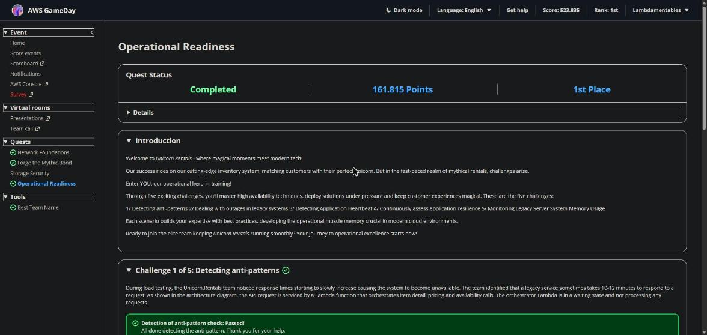
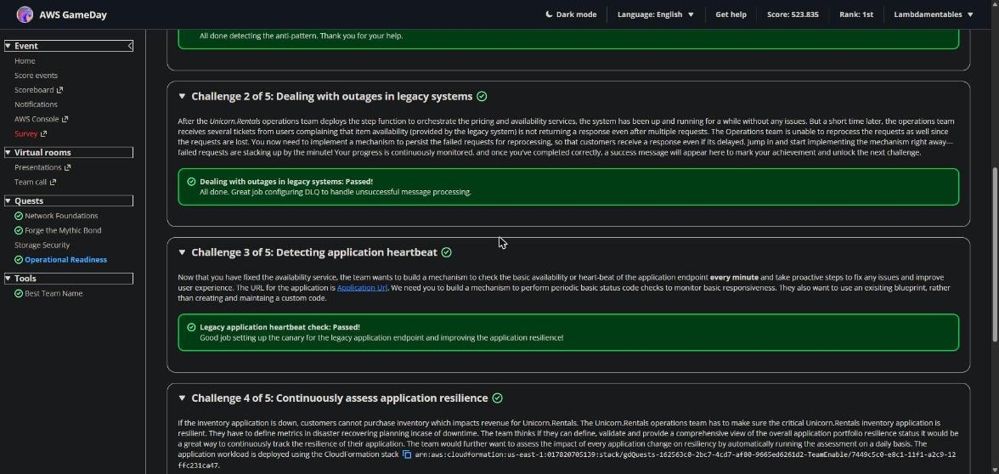
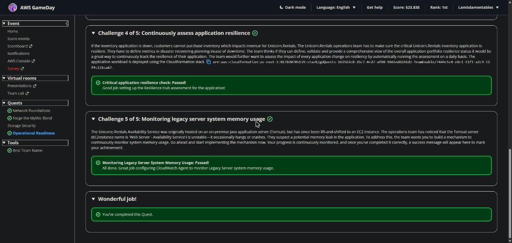

<div align="center">

# Quest 3 - Operational Readiness (Step Functions, SQS, Synthetics, Resilience Hub y CloudWatch Agent)


**Nombre en el GameDay:** *Operational Readiness* · 5 retos · us-east-1 · 161.815 puntos


</div>

> Esta quest la resolvió el compañero desde la consola. La guía está reconstruida a partir de la configuración que quedó en la cuenta (state machine, colas, canary, app de Resilience Hub, historial de Run Command y métricas) y de la página del GameDay. Lo que no se pudo comprobar está marcado con **(a confirmar)**.

## De qué va

El sistema de inventario de Unicorn.Rentals tiene un servicio heredado lento e inestable. Hay que aplicar buenas prácticas operativas en cinco retos:

1. Detectar el **antipatrón** de una Lambda que orquesta y se queda esperando.
2. No perder peticiones cuando el legacy falla: **dead-letter queue** en SQS.
3. Comprobar cada minuto que la app responde: **canary de CloudWatch Synthetics**.
4. Medir la resiliencia de forma continua: **AWS Resilience Hub** con evaluación diaria.
5. Vigilar la memoria del Tomcat: **CloudWatch Agent**.

## Arquitectura

```text
 API ──► Step Function "StateMachine" (Parallel)
           ├── GetItemsFromInventory   (detalle)
           ├── GetItemPrice            (precio)
           └── GenerateAvailabilityRequest ──► SQS AvailabilityRequestQueue ──(ESM)──► GetItemAvailabilityFromLegacy ──► Tomcat EC2 (legacy)
                                                     │  3 fallos (maxReceiveCount)                                          ▲
                                                     └──► SQS AvailabilityRequestDLQ (14 días)              CloudWatch Agent ┘ (mem_used_percent)
 CloudWatch Synthetics "unicorn-heartbeat" ── cada minuto ──► Application Url
 Resilience Hub "unicorn-inventory-app" ── evaluación diaria ──► stack gdQuests-...-TeamEnable
```

---

## Reto 1 - Detectar antipatrones

### Qué pide

Una Lambda orquesta tres llamadas (detalle, precio y disponibilidad) y se queda **esperando** al legacy, que tarda 10-12 minutos. Los tiempos suben hasta que el sistema cae.

### Cómo pensarlo

Es el antipatrón **"Lambda llamando a Lambda de forma síncrona"** u **orquestación dentro de una Lambda**:

- La Lambda orquestadora **paga mientras espera** y ocupa concurrencia. Con muchas peticiones se llega al límite de concurrencia y las nuevas se rechazan (*throttling*), que es el "se vuelve no disponible".
- Una Lambda tiene un **máximo de 15 minutos**: con un legacy de 10-12 minutos va al límite.
- Los errores y reintentos hay que programarlos a mano.

La solución de AWS es **sacar la orquestación a Step Functions** y **desacoplar** lo lento con una cola:

| Antes | Después |
|:--|:--|
| Lambda orquestadora llama a 3 Lambdas y espera | State machine con un estado **Parallel** de 3 ramas |
| Espera síncrona al legacy | `GenerateAvailabilityRequest` deja la petición en **SQS** y devuelve un `availability_id` al momento |
| Reintentos en el código | Reintentos y errores declarados en la state machine y en SQS |

La definición que quedó desplegada está en [`scripts/state-machine.asl.json`](scripts/state-machine.asl.json).

En la cuenta, la versión "arreglada" ya venía montada por el propio entorno desde el día anterior:

```text
API Gateway  GET /v1/getitem  ──(AWS_PROXY)──►  Lambda GetItemWorkflowTrigger  ──(sfn_arn)──►  Step Function "StateMachine"
```

Ninguno de esos recursos se modificó durante el GameDay. **(a confirmar)** cómo se validó exactamente el reto: la página no tiene caja de respuesta, así que todo apunta a que el check detectaba la solución (la orquestación con Step Functions) sin que hubiera que cambiar nada.

### Comprobación

*"All done detecting the anti-pattern."*

---

## Reto 2 - Peticiones fallidas al legacy: DLQ

### Qué pide

Las peticiones de disponibilidad al legacy fallan y **se pierden**. Hay que guardarlas para reprocesarlas.

### Cómo pensarlo

Las peticiones viajan por la cola `AvailabilityRequestQueue` y las consume `GetItemAvailabilityFromLegacy` mediante un *event source mapping*. Cuando la Lambda falla, el mensaje vuelve a la cola al acabar el *visibility timeout* y se reintenta. Pero la cola solo guardaba los mensajes **20 minutos** (`MessageRetentionPeriod=1200`), así que al final se perdían.

Solución: una **dead-letter queue** con una **redrive policy**:

| Atributo | Valor | Para qué |
|:--|:--|:--|
| `deadLetterTargetArn` | `AvailabilityRequestDLQ` | A dónde van los mensajes que fallan |
| `maxReceiveCount` | `3` | Tras 3 recepciones sin éxito, el mensaje pasa a la DLQ |
| Retención de la DLQ | 1.209.600 s (14 días, el máximo) | Margen para arreglar el legacy y reprocesar |

Cuando el legacy se recupera, **redrive** de la DLQ a la cola original (*Start DLQ redrive* en la consola, o `start-message-move-task`).

### Paso a paso en la consola

1. **SQS** → **Create queue** → *Standard* → **Name:** `AvailabilityRequestDLQ` → **Message retention period:** 14 días → **Create**.
2. Abrir `AvailabilityRequestQueue` → **Edit** → **Dead-letter queue:** *Enabled* → `AvailabilityRequestDLQ` → **Maximum receives:** `3` → **Save**.
3. Al rato, `AvailabilityRequestDLQ` → **Send and receive messages** → **Poll for messages** debe mostrar las peticiones fallidas.

### Con la CLI

Bloque *RETO 2* de [`scripts/comandos.sh`](scripts/comandos.sh).

### Comprobación

La DLQ llegó a tener **116 mensajes**: peticiones que antes se habrían perdido. *"Great job configuring DLQ to handle unsuccessful message processing."*

---

## Reto 3 - Heartbeat con CloudWatch Synthetics

### Qué pide

Comprobar **cada minuto** que el endpoint de la app responde con un código de estado correcto, **usando un blueprint** y sin código propio.

### Cómo pensarlo

**CloudWatch Synthetics** lanza *canaries*: scripts (Node.js con Puppeteer o Python con Selenium) que se ejecutan con una programación. El blueprint **Heartbeat monitoring** carga una URL, comprueba que el código HTTP es correcto y guarda una captura y un HAR en S3. Es justo lo que pide el reto.

### Paso a paso en la consola

1. **CloudWatch** → **Application Signals** → **Synthetics Canaries** → **Create canary**.
2. **Use a blueprint** → **Heartbeat monitoring** → **Name:** `unicorn-heartbeat`.
3. **Application or endpoint URL:** la *Application Url* del reto. En el GameDay era la API de la app: `https://<api-id>.execute-api.us-east-1.amazonaws.com/v1/getitem?id=1111`.
4. **Schedule:** *Run continuously* → cada **1 minuto**.
5. **Data storage:** el bucket que propone (`cw-synthetics-...`) → **Access permissions:** *Create a new role* (sale `CloudWatchSyntheticsRole-unicorn`) → **Create canary**.

### Comprobación

Canary en **RUNNING**, con las últimas ejecuciones en **PASSED**. *"Good job setting up the canary for the legacy application endpoint."*

---

## Reto 4 - Resilience Hub con evaluación diaria

### Qué pide

Definir objetivos de recuperación (RTO/RPO), validarlos y tener una vista de la resiliencia de la app de inventario, con **evaluación automática diaria**. La app está en el stack `gdQuests-...-TeamEnable`.

### Cómo pensarlo

**AWS Resilience Hub** tiene tres piezas:

| Pieza | En el GameDay |
|:--|:--|
| **Resiliency policy:** RTO/RPO objetivo por tipo de fallo (Software, Hardware, AZ y Región) | `unicorn-resiliency-policy`, tier *MissionCritical*, RTO = RPO = 3600 s en Software, Hardware y AZ |
| **Application:** los recursos, importados desde un stack de CloudFormation, Terraform, EKS o tags | `unicorn-inventory-app`, desde el stack del enunciado |
| **Assessment:** compara el RTO/RPO estimado de los recursos con la política y da recomendaciones | **Assessment schedule: Daily** + una evaluación inicial |

- **RTO** (*Recovery Time Objective*) es cuánto tiempo puede estar caída la app.
- **RPO** (*Recovery Point Objective*) es cuántos datos (medidos en tiempo) se pueden perder.

### Paso a paso en la consola

1. **Resilience Hub** → **Policies** → **Create resiliency policy** → `unicorn-resiliency-policy` → tier *Mission critical* → RTO/RPO de 1 hora → **Create**.
2. **Applications** → **Add application** → **Name:** `unicorn-inventory-app` → **Add resources:** *CloudFormation stacks* → el stack del enunciado.
3. **Resiliency policy:** `unicorn-resiliency-policy` → **Assessment schedule:** marcar *Automatically assess daily* → **Add application**.
4. **Publish new version** → **Assess resiliency**.

### Con la CLI

Bloque *RETO 4* de [`scripts/comandos.sh`](scripts/comandos.sh).

### Comprobación

Evaluación `initial-assessment` en **Success**, compliance **PolicyBreached** y puntuación **0.22**. Que no cumpla la política es lo esperable: el validador solo pide que la app, la política y la evaluación diaria existan. *"Good job setting up the Resilience Hub assessment."*

---

## Reto 5 - Memoria del Tomcat con CloudWatch Agent

### Qué pide

Monitorizar de forma continua la memoria de la EC2 `Web Server - Availability Service`, por una posible fuga de memoria.

### Cómo pensarlo

EC2 solo publica métricas del **hipervisor** (CPU, red, disco y *status checks*). La **memoria** (y el espacio libre en disco) solo se ven desde **dentro del sistema operativo**, así que hace falta el **CloudWatch Agent**. Publica en el namespace `CWAgent`. La instancia ya tenía SSM y un rol (`LegacyWebAppInstanceProfile`) con permiso para publicar métricas.

Configuración usada ([`scripts/amazon-cloudwatch-agent.json`](scripts/amazon-cloudwatch-agent.json)): las métricas `mem_used_percent`, `mem_available_percent`, `mem_used`, `mem_total` y `mem_available` cada 60 s, con la dimensión `InstanceId`.

### Paso a paso en la consola

1. **Systems Manager** → **Run Command** → `AWS-ConfigureAWSPackage` → **Name:** `AmazonCloudWatchAgent` → instancia `Web Server - Availability Service` → **Run**.
2. Crear la configuración: con el asistente (`amazon-cloudwatch-agent-config-wizard`) en la instancia, o guardando el JSON en **Parameter Store** y usando `AmazonCloudWatch-ManageAgent`.
3. Arrancar el agente con `amazon-cloudwatch-agent-ctl -a fetch-config -m ec2 -s -c file:<json>`.
4. **CloudWatch** → **Metrics** → **CWAgent** → `InstanceId` → aparece `mem_used_percent`.

### Con la CLI

Bloque *RETO 5* de [`scripts/comandos.sh`](scripts/comandos.sh). Es lo que se hizo de verdad: Run Command con el JSON en base64.

### Comprobación

Las 5 métricas `mem_*` del namespace `CWAgent` aparecen con la dimensión de la instancia. *"Great job configuring CloudWatch Agent to monitor Legacy Server system memory usage."*

---

## Capturas del GameDay

La página de la quest entera, de arriba abajo, con los 5 retos superados. La quest no traía diagramas.







## Cómo lo resolvimos

Esta quest la hizo el compañero, sobre todo desde la **consola**, en paralelo a las quests de red. El orden, según las fechas de los recursos en la cuenta:

| Hora | Qué se hizo |
|:--|:--|
| — | Reto 1 superado sin cambios en la cuenta (la Step Function ya existía) |
| — | Reto 2: DLQ `AvailabilityRequestDLQ` + redrive policy con `maxReceiveCount = 3` en `AvailabilityRequestQueue` |
| 10:17-10:19 | Reto 3: rol `CloudWatchSyntheticsRole-unicorn` y canary `unicorn-heartbeat` con el blueprint *Heartbeat monitoring*, cada minuto |
| 10:22 | Reto 4: política `unicorn-resiliency-policy` y app `unicorn-inventory-app` desde el stack, con evaluación diaria y una evaluación inicial |
| 10:35 | Reto 5, primer intento: Run Command con heredoc. **Falló** |
| 10:36 | Reto 5, segundo intento: el mismo JSON en base64. Funcionó; métricas `mem_*` en `CWAgent` |

---

## Errores típicos

| Síntoma | Causa | Solución |
|:--|:--|:--|
| El Run Command del agente falla al escribir el JSON | Heredoc (`cat << EOF`) con `\n` escapados dentro del parámetro `commands` | Pasar el JSON en base64 y `base64 -d` en la instancia |
| No aparecen métricas de memoria | EC2 no mide memoria sin agente, o el rol no tiene `CloudWatchAgentServerPolicy` | Instalar el agente y revisar el rol de la instancia |
| Los mensajes desaparecen sin llegar a la DLQ | La retención de la cola original acaba antes de los `maxReceiveCount` intentos | Retención mayor que *visibility timeout × maxReceiveCount* |
| Mensajes en la DLQ que nadie mira | La DLQ no avisa sola | Alarma en `ApproximateNumberOfMessagesVisible` de la DLQ |
| Canary en FAILED | URL mal puesta, o la app responde 4xx/5xx | Mirar la captura y el HAR del bucket de artefactos |
| Evaluación de Resilience Hub en *PolicyBreached* | La app no tiene la redundancia que exige la política | Normal en el reto: el validador solo pide la configuración |

## Preguntas de repaso

<details>
<summary>¿Por qué es un antipatrón que una Lambda orqueste otras Lambdas y espere?</summary>

Porque **pagas el tiempo de espera** de la orquestadora (y de cada nivel), consumes **concurrencia** que otras peticiones necesitan, el límite de **15 minutos** se queda corto con servicios lentos y los errores y reintentos van en el código. Step Functions orquesta sin coste de espera (Standard cobra por transición), con reintentos, `Catch`, paralelismo y esperas de hasta un año.
</details>

<details>
<summary>¿Qué es una dead-letter queue y qué controla maxReceiveCount?</summary>

Una cola SQS donde acaban los mensajes que no se han podido procesar. `maxReceiveCount` es cuántas veces se puede **recibir** un mensaje sin borrarlo antes de moverlo a la DLQ. La DLQ tiene que ser del mismo tipo que la original (Standard o FIFO) y, en la práctica, tener mayor retención.
</details>

<details>
<summary>¿Qué diferencia hay entre la DLQ de una cola SQS y la DLQ o los destinos de una Lambda?</summary>

La **DLQ de SQS** (redrive policy) actúa cuando la Lambda lee de la cola mediante un *event source mapping*. La **DLQ de Lambda** y los **destinos on-failure** son para **invocaciones asíncronas**, como S3 o SNS invocando la Lambda. En este reto la Lambda lee de SQS, así que la DLQ va en la cola.
</details>

<details>
<summary>¿Qué blueprints tiene CloudWatch Synthetics?</summary>

*Heartbeat monitoring* (carga una URL y comprueba el estado), *API canary* (peticiones REST), *Broken link checker*, *Canary recorder* (graba pasos en el navegador), *GUI workflow builder* y *Visual monitoring* (compara capturas con una referencia).
</details>

<details>
<summary>¿Qué son RTO y RPO y qué tiers de política trae Resilience Hub?</summary>

**RTO** es el tiempo máximo de caída aceptable y **RPO** la pérdida de datos máxima aceptable, medida en tiempo. Resilience Hub trae políticas sugeridas por tier: *Mission critical*, *Critical*, *Important*, *Core services*, *Non-critical*, y además se pueden crear políticas propias con RTO/RPO por tipo de fallo (Software, Hardware, AZ y Región).
</details>

<details>
<summary>¿Qué métricas de una EC2 necesitan el CloudWatch Agent?</summary>

Las del **sistema operativo**: memoria (`mem_used_percent`), uso de disco por sistema de ficheros (`disk_used_percent`), swap, procesos y, en Windows, contadores de rendimiento. Además, el agente puede enviar **logs** de ficheros a CloudWatch Logs. CPU, red, IOPS de EBS y *status checks* los da EC2 sin agente.
</details>

## Contenido

| Ruta | Descripción |
|:--|:--|
| [`enunciado.md`](enunciado.md) | Enunciado de los 5 retos |
| [`scripts/comandos.sh`](scripts/comandos.sh) | Equivalente por CLI de los 5 retos |
| [`scripts/state-machine.asl.json`](scripts/state-machine.asl.json) | Definición de la state machine desplegada (Parallel con 3 ramas) |
| [`scripts/amazon-cloudwatch-agent.json`](scripts/amazon-cloudwatch-agent.json) | Configuración del CloudWatch Agent (métricas de memoria) |
| [`capturas/`](capturas) | La página de la quest en el GameDay, entera, con los 5 retos superados |

---

[Volver al índice del GameDay](../README.md)
