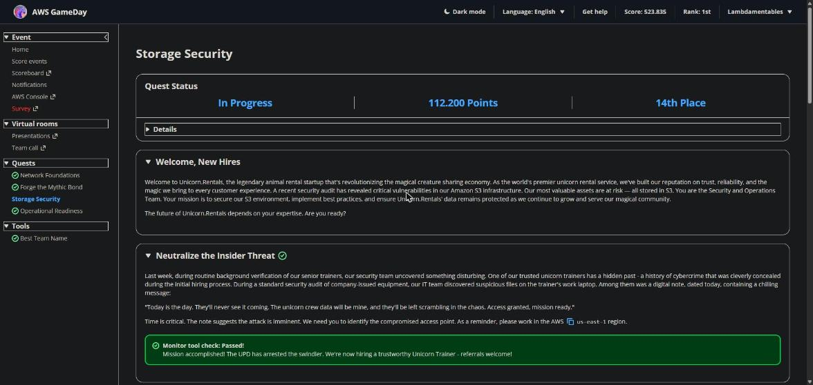
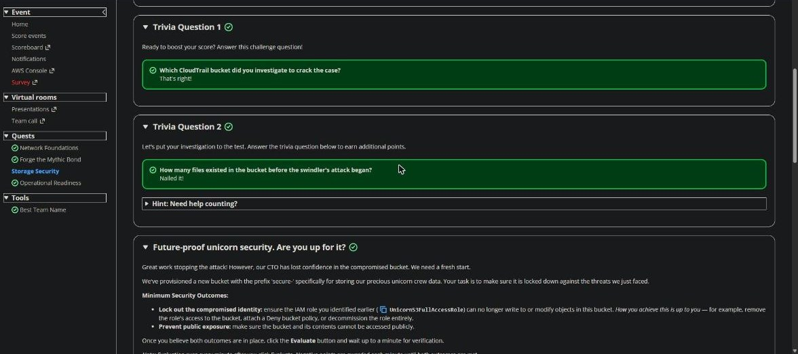
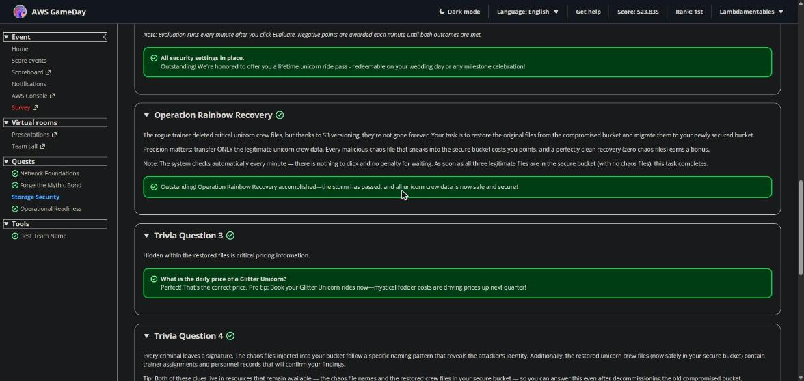
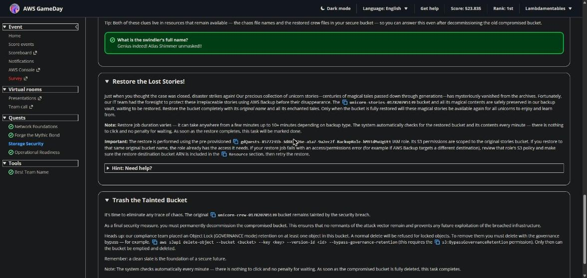
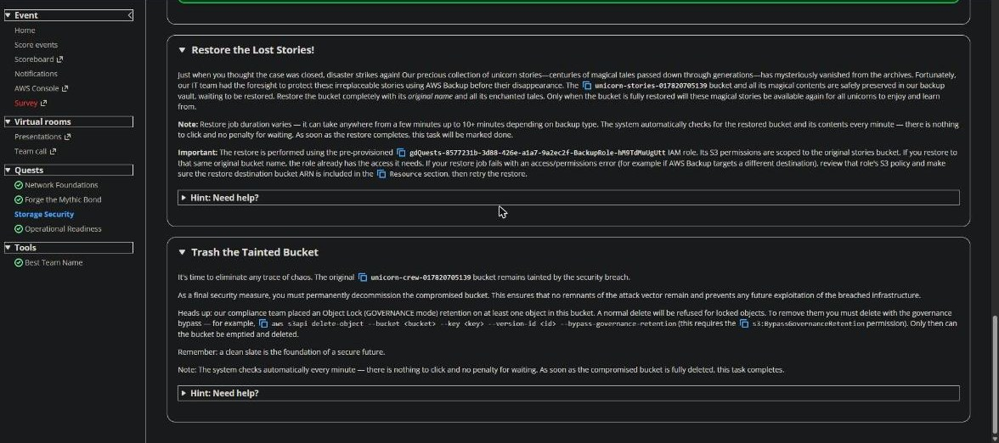

<div align="center">

# Quest 4 - Storage Security (CloudTrail, S3 y AWS Backup)


**Nombre en el GameDay:** *Storage Security* · 5 tareas + 4 preguntas · us-east-1 · 112.200 puntos (en curso)


</div>

> Esta quest la llevaba el compañero, con la consola y la AWS CLI desde Ubuntu. Están hechas las tareas 1 a 4 y las 4 preguntas. La guía está reconstruida a partir de **CloudTrail** (qué llamada se hizo, cuándo y desde dónde), de lo que quedó en la cuenta y de la página del GameDay. La tarea 5 estaba **pendiente** cuando se escribió: aquí está el planteamiento, sin ejecutar.

## De qué va

Un entrenador de Unicorn.Rentals con pasado de ciberdelincuente ataca el bucket de la tripulación: borra los ficheros buenos y lo llena de ficheros basura (`chaos_file_*`). Hay que:

1. **Encontrar al culpable** con CloudTrail: el rol `UnicornS3FullAccessRole`.
2. **Blindar** el bucket nuevo `secure-`: Deny al rol y Block Public Access.
3. **Recuperar** los 3 ficheros legítimos con el **versionado** de S3.
4. **Restaurar** un bucket borrado desde **AWS Backup**.
5. **Eliminar** el bucket comprometido, que tiene **Object Lock** *(pendiente)*.

| Tarea / pregunta | Estado |
|:--|:-:|
| 1 - Neutralizar la amenaza interna | Resuelta |
| Pregunta 1 - Bucket de CloudTrail | Resuelta |
| Pregunta 2 - Ficheros antes del ataque | Resuelta |
| 2 - Blindar el bucket `secure-` | Resuelta |
| 3 - Rainbow Recovery | Resuelta |
| Pregunta 3 - Precio del Glitter Unicorn | Resuelta (*$1000/día*) |
| Pregunta 4 - Nombre del estafador | Resuelta (*Atlas Shimmer*) |
| 4 - Restaurar las historias (AWS Backup) | Hecha: restore `COMPLETED` a las 11:32 con las 3 historias |
| 5 - Eliminar el bucket contaminado | Pendiente |

## Arquitectura

```text
 Entrenador ──assume──► UnicornS3FullAccessRole ──► unicorn-crew-<cuenta>
                                                     ├── Delete de rental-fees / trainer-details / unicorn-details (quedan como versiones antiguas)
                                                     └── Put de 1.900 chaos_file_Atlas_*.txt
 CloudTrail "unicorn-crew-trail" ──► unicorn-cloudtrail-<cuenta>   (eventos de datos de S3: aquí se ve quién fue)

 secure-unicorn-crew-<cuenta>:  Deny s3:* al rol  +  Block Public Access (4/4)  ◄── 3 versiones buenas (tarea 3)
 AWS Backup "unicorn-stories-backup-vault" (2 recovery points) ──restore──► unicorn-stories-<cuenta> (tarea 4)
```

---

## Tarea 1 - Encontrar el punto de acceso comprometido

### Qué pide

Identificar por dónde está atacando el entrenador.

### Cómo pensarlo

- **CloudTrail** registra quién hace qué. Por defecto solo guarda eventos de **gestión** (crear buckets, cambiar políticas). Para ver `PutObject` y `DeleteObject` hacen falta **eventos de datos**, y el trail del reto, `unicorn-crew-trail`, los tenía activados. Ese es el que se investiga; los otros dos son del propio evento.
- Los logs están en el bucket **`unicorn-cloudtrail-<cuenta>`**. Filtrando por `eventSource = s3.amazonaws.com` sobre `unicorn-crew-<cuenta>`, los `DeleteObject` y los `PutObject` de `chaos_file_*` aparecen con `userIdentity.arn` = una sesión de **`UnicornS3FullAccessRole`**.
- El rol se puede asumir desde la propia cuenta (`:root`) y tiene `UnicornS3FullAccessPolicy` (acceso total a S3).

La tarea no tiene caja de respuesta: el *"Monitor tool check"* mira la cuenta. Según CloudTrail, lo que se hizo fue **bloquear al sospechoso con una política del bucket**:

1. **10:10-10:14:** la primera sospecha fue **`availability-lambda-role`**. Hubo 4 intentos de política rechazados (`MalformedPolicy`: el JSON pegado en el editor no era válido, por ejemplo una sentencia suelta sin `Version` ni `Statement`). A las 10:14 entró un **Deny** a ese rol.
2. **10:21:** desde la CLI se añadió una segunda sentencia, con el **Deny a `UnicornS3FullAccessRole`**, el rol que de verdad aparece en los eventos del ataque. A partir de ahí, la tarea dio *Passed*.
3. El Deny a `availability-lambda-role` se quedó puesto. Sobra (no es el atacante), pero en ese bucket no molesta.

### El error que conviene recordar

`MalformedPolicy` sale cuando el editor recibe algo que no es una política completa. La forma mínima válida es:

```json
{ "Version": "2012-10-17",
  "Statement": [ { "Sid": "...", "Effect": "Deny", "Principal": { "AWS": "arn:aws:iam::<cuenta>:role/<rol>" },
                   "Action": "s3:*", "Resource": [ "arn:aws:s3:::<bucket>", "arn:aws:s3:::<bucket>/*" ] } ] }
```

### Preguntas extra

| Pregunta | Respuesta |
|:--|:--|
| ¿Qué bucket de CloudTrail se investigó? | `unicorn-cloudtrail-<cuenta>`, el destino del trail del reto `unicorn-crew-trail` (los otros dos trails son del evento) |
| ¿Cuántos ficheros había antes del ataque? | **3**: `rental-fees.txt`, `trainer-details.txt` y `unicorn-details.txt` (las únicas versiones que no son `chaos_file_*`) |

### Con la CLI

Bloque *TAREA 1* de [`scripts/comandos.sh`](scripts/comandos.sh): trails, descarga de logs, filtro con `jq` y recuento de versiones.

---

## Tarea 2 - Blindar el bucket secure-

### Qué pide

Que `UnicornS3FullAccessRole` no pueda escribir ni modificar en el bucket `secure-`, y que el bucket no sea público. Después se pulsa **Evaluate**. Resta puntos cada minuto hasta que se cumple.

### Cómo pensarlo

- **Deny explícito en la política del bucket.** En la evaluación de IAM, un **Deny explícito gana siempre**, aunque la política del rol diga `s3:*` Allow. Es más rápido y más seguro que tocar el rol, porque el validador también usa roles de la cuenta.
- **Block Public Access** con las 4 opciones activadas: bloquea ACL públicas nuevas, ignora las existentes, bloquea políticas públicas y restringe el acceso si ya hubiera una.

### Paso a paso en la consola

1. **S3** → `secure-unicorn-crew-<cuenta>` → **Permissions**.
2. **Block public access (bucket settings)** → **Edit** → marcar **Block all public access** → **Save** → escribir `confirm`.
3. **Bucket policy** → **Edit** → pegar [`scripts/politica-bucket-secure.json`](scripts/politica-bucket-secure.json), cambiando `ACCOUNT_ID` → **Save**.
4. En el GameDay → **Evaluate**.

### Comprobación

*"All security settings in place."*

---

## Tarea 3 - Rainbow Recovery

### Qué pide

Llevar **solo** los 3 ficheros legítimos del bucket comprometido al bucket seguro. Cada `chaos_file_*` que entre resta puntos, y cero ficheros de caos da bonus.

### Cómo pensarlo

- Con el **versionado** activo, un borrado no borra nada: pone un **delete marker** como versión actual. Las versiones antiguas siguen ahí.
- En `unicorn-crew-<cuenta>` hay 1.900 versiones de `chaos_file_*` y 3 legítimas, del 25/11, con `IsLatest = false` porque encima tienen su delete marker.
- Lo más limpio es copiar **cada versión buena directamente** al bucket seguro con `copy-object --copy-source "bucket/key?versionId=..."`. No hay que tocar el bucket comprometido ni usar `aws s3 sync`, que arrastraría los ficheros de caos.
- Copiar al bucket seguro funciona porque el Deny es solo para `UnicornS3FullAccessRole`, no para el rol del participante.

### Paso a paso en la consola

Abrir el bucket comprometido → **Show versions** → para cada uno de los 3 ficheros, seleccionar su versión antigua → **Actions** → **Copy** → destino el bucket `secure-`.

### Con la CLI

Bloque *TAREA 3* de [`scripts/comandos.sh`](scripts/comandos.sh).

### Comprobación

*"Outstanding! Operation Rainbow Recovery accomplished—the storm has passed, and all unicorn crew data is now safe and secure!"*

### Preguntas extra 3 y 4

Las dos se responden **leyendo** los ficheros recuperados (`aws s3 cp s3://secure-.../rental-fees.txt -`):

| Pregunta | Dónde mirar | Estado |
|:--|:--|:-:|
| Precio diario de un Glitter Unicorn | `rental-fees.txt` → *Daily Rental Rates* | Resuelta: **$1000/día** (*"Perfect! That's the correct price"*) |
| Nombre completo del estafador | El patrón de los ficheros de caos (`chaos_file_Atlas_*`: el nombre "Atlas") cruzado con `trainer-details.txt`, donde *Atlas Shimmer* (TR-002) sale con *Background Check: UNDER REVIEW* | Resuelta: **Atlas Shimmer** (*"Genius indeed! Atlas Shimmer unmasked!!"*) |

---

## Tarea 4 - Restaurar las historias desde AWS Backup

### Qué pide

Restaurar el bucket `unicorn-stories-<cuenta>`, ahora borrado, **con su nombre original**, desde el vault de AWS Backup.

### Cómo pensarlo

- El vault `unicorn-stories-backup-vault` tiene **2 recovery points**. Se usa el más reciente.
- El restore de S3 puede crear un bucket nuevo (`NewBucket=true`). Como el bucket original ya no existe, se puede restaurar con el mismo nombre.
- Hay que usar el rol **`gdQuests-...-BackupRole-...`**: sus permisos de S3 solo cubren el ARN del bucket original. Si se restaurase con otro nombre, habría que añadir ese ARN al `Resource` de su política.
- Tarda de unos minutos a más de 10. El GameDay lo comprueba solo cada minuto.

### Paso a paso en la consola

**AWS Backup** → **Backup vaults** → `unicorn-stories-backup-vault` → el recovery point más reciente → **Restore** → *Restore to a new bucket* → nombre `unicorn-stories-<cuenta>` → **IAM role:** el `...BackupRole...` → **Restore backup**.

### Con la CLI

Bloque *TAREA 4* de [`scripts/comandos.sh`](scripts/comandos.sh).

### Comprobación

Así se hizo: desde la **consola** a las 11:32:21, con el recovery point `unicorn-stories-<cuenta>-20261125111619` y el `...BackupRole...`. AWS Backup creó el bucket a las 11:32:51 (con el versionado activado) y a las 11:34:51 estaban las 3 historias: `stories/crystal-horn.txt`, `stories/magical-rainbow.txt` y `stories/starlight-dance.txt`. Estado del trabajo: **COMPLETED**.

---

## Tarea 5 - Eliminar el bucket contaminado *(pendiente)*

### Qué pide

Eliminar de forma permanente `unicorn-crew-<cuenta>`. Al menos un objeto tiene **Object Lock en modo GOVERNANCE**.

### Cómo pensarlo

- Un bucket solo se puede borrar **vacío**, y en un bucket versionado "vacío" significa **sin ninguna versión ni delete marker**. Aquí hay unas 1.900 versiones de `chaos_file_*`, sus delete markers y las 3 versiones legítimas.
- **Hacer antes la tarea 3:** al borrar el bucket se pierden las versiones buenas. Por eso el orden del reto es recuperar primero y borrar al final.
- **Object Lock:**
  - En modo **GOVERNANCE**, un objeto retenido solo se puede borrar con `--bypass-governance-retention` y el permiso `s3:BypassGovernanceRetention`.
  - En modo **COMPLIANCE** no lo puede borrar nadie, ni siquiera root, hasta que acabe la retención.
- La consola tiene la opción **Empty**, pero no siempre salta el Object Lock. Por CLI se borran todas las versiones con `delete-objects` por lotes de 1.000 y después los objetos bloqueados uno a uno con el bypass.

### Plan

Bloque *TAREA 5* de [`scripts/comandos.sh`](scripts/comandos.sh): buscar los objetos con retención, borrarlos con bypass, vaciar el resto de versiones por lotes y `delete-bucket`.

---

## Cómo lo resolvimos

La quest la llevó el compañero, con la **consola** y la **AWS CLI** desde Ubuntu. La cronología sale de **CloudTrail**: los eventos de gestión con `lookup-events`, y los de S3 de los logs del trail `unicorn-crew-trail`.

| Hora | Herramienta | Qué se hizo |
|:--|:--|:--|
| 10:02-10:04 | CLI y consola | Reconocimiento: `ListAccessPoints`, `GetBucketPolicy` y vistas del bucket en la consola |
| 10:10-10:13 | Consola | 4 intentos de política en el bucket comprometido rechazados por `MalformedPolicy` |
| 10:14 | Consola | Política aceptada: Deny a `availability-lambda-role` (primera sospecha, equivocada) |
| 10:21 | CLI | Se añade el **Deny a `UnicornS3FullAccessRole`**, el atacante real. Tarea 1 superada |
| 10:37 | CLI | Tarea 2: **Block Public Access** 4/4 en `secure-unicorn-crew-<cuenta>` |
| 10:43-10:49 | Consola | Retoques de la política del bucket comprometido (cambio de nombre del `Sid`) |
| 10:49 | Consola | Falla la política del bucket `secure-` (`MalformedPolicy`: JSON incompleto en el editor) |
| 10:52 | Consola | Tarea 2: política del bucket `secure-` con el Deny a `UnicornS3FullAccessRole`. Después, *Evaluate* |
| 11:05-11:10 | Consola | Tarea 3: se revisa el bucket comprometido y se copian a mano las 3 versiones buenas al bucket `secure-` (11:08, 11:09 y 11:10) |
| — | Lectura | Preguntas 3 y 4 respondidas leyendo los ficheros recuperados |
| 11:32 | Consola | Tarea 4: restore de AWS Backup al bucket original; completado a las 11:34 |
| — | — | Tarea 5 (borrar el bucket con Object Lock): pendiente al escribir la guía |

> Lo que se aprende de los fallos: `MalformedPolicy` es casi siempre un JSON incompleto en el editor. Y conviene confirmar en los eventos **quién** hizo el ataque antes de bloquear a nadie: el primer Deny fue al rol equivocado.

---

## Capturas del GameDay

La página de la quest entera, de arriba abajo, en el estado en que estaba al escribir la guía:

<details>
<summary>Ver las 5 capturas</summary>











</details>

---

## Errores típicos

| Síntoma | Causa | Solución |
|:--|:--|:--|
| CloudTrail no muestra los `PutObject` | Solo hay eventos de gestión | Usar el trail con **eventos de datos** de S3 (`unicorn-crew-trail`) |
| El rol sigue escribiendo pese a quitarle permisos | Sesiones ya asumidas siguen valiendo hasta que caducan | Deny en la política del bucket: se evalúa en cada petición |
| *Evaluate* sigue restando puntos | Falta una de las 4 opciones de Block Public Access | Activar *Block all public access* |
| Entran ficheros de caos al bucket seguro | `aws s3 sync` o copia de todo el bucket | Copiar solo las 3 versiones por `versionId` |
| El restore de Backup falla con *AccessDenied* | Destino con otro nombre, fuera de la política del BackupRole | Restaurar con el nombre original, o añadir el ARN al rol |
| *BucketNotEmpty* al borrar el bucket | Quedan versiones antiguas o delete markers | Borrar **todas** las versiones, no solo los objetos actuales |
| *AccessDenied* al borrar una versión | Object Lock en GOVERNANCE | `--bypass-governance-retention` (con `s3:BypassGovernanceRetention`) |
| Al borrar el bucket se pierden los ficheros buenos | Se borró antes de recuperar | Hacer siempre primero la tarea 3 |

## Preguntas de repaso

<details>
<summary>¿Qué diferencia hay entre eventos de gestión y eventos de datos en CloudTrail?</summary>

Los de **gestión** (*control plane*) son operaciones sobre recursos: `CreateBucket`, `PutBucketPolicy`, `AssumeRole`... Se registran por defecto. Los de **datos** (*data plane*) son operaciones dentro del recurso: `GetObject`, `PutObject`, `DeleteObject` en S3 o `Invoke` en Lambda. Hay que activarlos en el trail, porque son muchos y se pagan aparte.
</details>

<details>
<summary>¿Por qué un Deny en la política del bucket gana a un Allow s3:* en la política del rol?</summary>

En la lógica de evaluación de AWS, un **Deny explícito** en cualquier política aplicable (identidad, recurso, SCP, permissions boundary o sesión) **siempre gana**. Después hace falta al menos un Allow. Si no hay ninguno, se aplica el Deny implícito.
</details>

<details>
<summary>¿Qué hacen las 4 opciones de S3 Block Public Access?</summary>

- `BlockPublicAcls`: rechaza ACL públicas nuevas.
- `IgnorePublicAcls`: ignora las ACL públicas que ya existan.
- `BlockPublicPolicy`: rechaza políticas de bucket que den acceso público.
- `RestrictPublicBuckets`: si ya hay una política pública, limita el acceso a principales de AWS y de la cuenta.

Se configuran por bucket y por cuenta.
</details>

<details>
<summary>¿Qué es un delete marker y cómo se recupera un objeto borrado con versionado?</summary>

Al borrar sin `versionId` en un bucket versionado, S3 no borra datos: crea un **delete marker** como versión actual, y el objeto "desaparece" del listado normal. Para recuperarlo se **borra el delete marker** (la versión anterior vuelve a ser la actual) o se **copia la versión antigua** a donde haga falta. Borrar con `versionId` sí elimina esa versión para siempre.
</details>

<details>
<summary>¿Qué protecciones extra habrían evitado el ataque?</summary>

- **MFA Delete** (borrar versiones exige MFA).
- **S3 Object Lock** en modo *compliance* o *governance*.
- **Mínimo privilegio** en lugar de `s3:*`, y una trust policy restringida en el rol.
- **Replicación** a otra cuenta.
- **AWS Backup** con un vault con *Vault Lock*.
- **GuardDuty S3 Protection** para detectar accesos anómalos.
</details>

<details>
<summary>¿Cómo funciona el restore de S3 en AWS Backup?</summary>

Restaura desde un recovery point (continuo o periódico) a un bucket **existente** o **nuevo**, todo el bucket o solo algunos prefijos. AWS Backup usa un **rol IAM** que tiene que poder escribir en el bucket destino. El bucket original necesita tener **versionado** para poder hacer backups de S3.
</details>

## Contenido

| Ruta | Descripción |
|:--|:--|
| [`enunciado.md`](enunciado.md) | Enunciado de las 5 tareas y las 4 preguntas |
| [`scripts/comandos.sh`](scripts/comandos.sh) | Investigación, blindaje, recuperación por versiones y plan de las tareas 4 y 5 |
| [`scripts/politica-bucket-secure.json`](scripts/politica-bucket-secure.json) | Política del bucket `secure-` con el Deny al rol comprometido |
| [`capturas/`](capturas) | La página de la quest en el GameDay, entera |

---

[Volver al índice del GameDay](../README.md)
