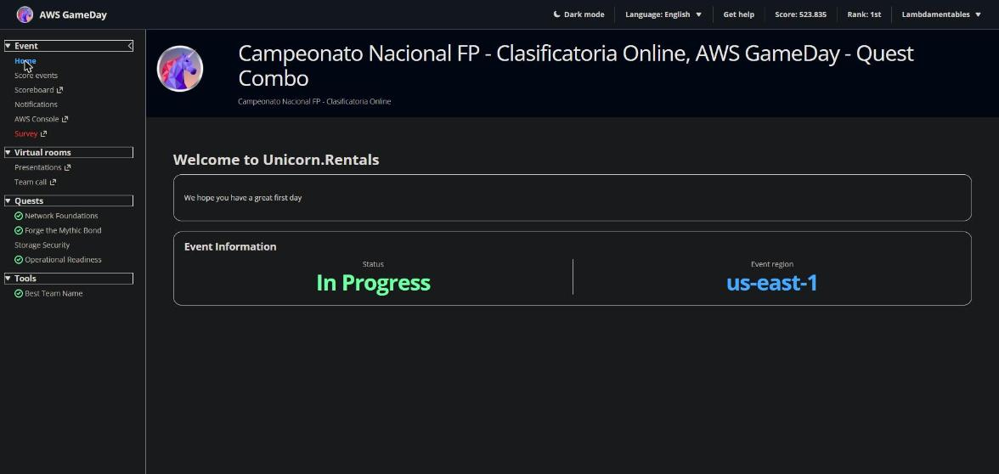
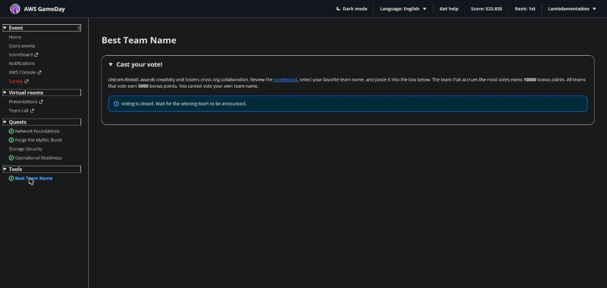

<div align="center">


</div>

## Qué es esto

Guía de estudio de las **4 quests** del AWS GameDay de **Unicorn.Rentals**, hecho en clase en equipo el 26/11/2026, el día después del [AWS Jam](../AWS-Jam-2026). El evento era el **Campeonato Nacional FP - Clasificatoria Online, AWS GameDay - Quest Combo** (región us-east-1). El equipo **Lambdamentables** iba **1.º** con **523.835 puntos** cuando se escribió esta guía.

<div align="center">

| Portada del evento | Votación *Best Team Name* (cerrada) |
|:-:|:-:|
|  |  |

</div>

Para cada quest hay:

- **Enunciado** de cada tarea, traducido.
- **Cómo pensarlo**: qué hay que mirar y por qué, antes de tocar nada.
- **Paso a paso en la consola**, con menús, botones y campos.
- **Paso a paso con la AWS CLI**, con todos los comandos en `scripts/comandos.sh`.
- **Comprobación**: cómo saber que está bien.
- **Errores típicos** que aparecieron de verdad y cómo se resolvieron.
- **Preguntas de repaso** con la respuesta desplegable, para estudiar tipo examen.

## Las quests

<div align="center">

| # | Quest (nombre en el GameDay) | Servicios | Tareas | Puntos | Estado |
|:-:|:--|:--|:-:|:-:|:-:|
| 1 | [Network Foundations](Quest-1-Network-Foundations) | VPC IPAM, CloudFormation, Transit Gateway, NAT | 3 | 149.910 |  |
| 2 | [Forge the Mythic Bond](Quest-2-Forge-the-Mythic-Bond) | PrivateLink, NLB, AWS WAF | 2 | 84.910 |  |
| 3 | [Operational Readiness](Quest-3-Operational-Readiness) | Step Functions, SQS DLQ, Synthetics, Resilience Hub, CloudWatch Agent | 5 | 161.815 |  |
| 4 | [Storage Security](Quest-4-Storage-Security) | CloudTrail, S3, IAM, AWS Backup | 5 + 4 preguntas | 112.200 |  |

</div>

Las quests 1 y 2 se hicieron por CLI; la 3 y la 4 las hizo el compañero desde la consola, y su guía está reconstruida a partir de lo que quedó en la cuenta. En la Quest 4 faltaban, al escribir esto, el restore de AWS Backup y el borrado del bucket con Object Lock: está el planteamiento, sin ejecutar.

## Cómo lo resolvimos

| Quest | Quién | Cómo |
|:--|:--|:--|
| Network Foundations | Pau | AWS CLI desde PowerShell, con un asistente de IA (**Claude Code**) que proponía y lanzaba los comandos; cada paso se comprobó con `describe-...` antes de seguir |
| Forge the Mythic Bond | Pau | Igual: CLI y Claude Code, con pruebas reales por `curl` desde la EC2 mediante SSM Run Command |
| Operational Readiness | Compañero | Consola de AWS |
| Storage Security | Compañero | Consola de AWS |

Cada README tiene un apartado **Cómo lo resolvimos** con el orden real de los pasos, los fallos que salieron y cómo se arreglaron. Las carpetas `capturas/` tienen los diagramas del enunciado y la página de cada quest del GameDay entera, de arriba abajo, para leer el enunciado original en inglés. La carpeta `capturas/` de este índice tiene la portada del evento y la herramienta *Best Team Name* (votar por el nombre de otro equipo daba 5.000 puntos extra).

## GameDay frente a Jam

| | AWS Jam (25/11) | AWS GameDay (26/11) |
|:--|:--|:--|
| Cuentas | Una cuenta **por reto** | **Una sola cuenta** para todo el equipo y todas las quests |
| Orden | Retos independientes | Quests con historia; las tareas se desbloquean en orden y algunas dependen de lo anterior (los pools de IPAM alimentan el stack de red) |
| Validación | *Check my progress* o respuesta | Automática cada 1-2 minutos, respuesta en una caja o botón **Evaluate** |
| Penalizaciones | Pistas | Pistas y, en alguna tarea, **puntos negativos por minuto** hasta que se cumple (Storage Security, tarea 2) |
| Credenciales | Botón >_AWS_CLI de cada reto | **AWS Console** → *Command line access* del portal (Workshop Studio, rol `WSParticipantRole/Participant`) |

### Usar la CLI con las credenciales del GameDay

El portal da las variables en formato PowerShell (`$Env:AWS_ACCESS_KEY_ID=...`) y CMD (`set ...`): son las mismas claves en dos formatos. Para no depender de la terminal, se guardan en un perfil:

```bash
aws configure set aws_access_key_id     ASIA...  --profile gameday
aws configure set aws_secret_access_key ...      --profile gameday
aws configure set aws_session_token     ...      --profile gameday
aws configure set region us-east-1               --profile gameday
aws sts get-caller-identity --profile gameday    # rol WSParticipantRole/Participant
```

> Caducan (`ExpiredToken`): se vuelven a copiar del portal. El key pair `ws-default-keypair` que aparece en la cuenta es para SSH a EC2, **no** son credenciales.

## Método para cualquier quest

1. **Leer la tarea entera** y ver qué valida: un ID en una caja, un camino de red, una URL...
2. **Reconocimiento antes de tocar:** `describe-...` de todo lo que hay (VPC, subredes, tablas de rutas, LB, SG). En Network Foundations, ver que el TGW tenía la asociación y la propagación por defecto desactivadas cambió todo el diseño.
3. **Pensar en la siguiente tarea:** el GameDay avisa de que las decisiones influyen en las quests siguientes (TGW con dos tablas y appliance mode pensando en el futuro Network Firewall).
4. **Esperar a que el recurso esté listo** antes de dar algo por roto: attachments `pending`, targets `initial`, stacks `CREATE_IN_PROGRESS`.
5. **Comprobar con datos desde dentro:** `curl` desde la EC2 por **SSM Run Command**, con `200`/`403` como prueba.
6. **El validador va con retraso:** mirar la hora de *Last updated* antes de pensar que algo falla.

## Lecciones generales del GameDay

| Lección | Dónde salió |
|:--|:--|
| Un **espacio** al pegar un ID basta para que lo dé por inválido | Pool regional de IPAM (Quest 1) |
| En IPAM, *min netmask length* = bloque **más grande** | Reglas de asignación (Quest 1) |
| El validador puede comprobar **antes** de que el recurso termine: mirar la hora | Stack de CloudFormation y rutas (Quest 1) |
| En egress centralizado, la **vuelta** del NAT necesita ruta al TGW en las subredes públicas | Quest 1, tarea 3 |
| Con CIDR solapados, **PrivateLink** (servicio) y no peering ni TGW (redes) | Quest 2 |
| PrivateLink solo va con **NLB**: delante de un ALB, NLB con target group tipo `alb` | Quest 2 |
| WAF se pone en el **ALB**, no en el NLB | Quest 2 |
| Un *timeout* justo después de crear algo suele ser un target aún en `initial` | Quest 2 |
| Orquestar en una Lambda que espera es un **antipatrón**: Step Functions + cola | Quest 3, reto 1 |
| Las peticiones que fallan se guardan con una **DLQ** (redrive policy) | Quest 3, reto 2 |
| La memoria de una EC2 solo se ve con el **CloudWatch Agent** | Quest 3, reto 5 |
| En Run Command, un JSON con varias líneas se pasa mejor en **base64** | Quest 3, reto 5 |
| **Deny explícito** en la política del bucket gana a cualquier Allow | Quest 4, tarea 2 |
| Con versionado, "borrar" es poner un **delete marker**: se recupera por `versionId` | Quest 4, tarea 3 |
| PowerShell rompe comillas y variables en argumentos de la CLI | `"Id=$arn,Port=80"`, `--parameters file://cmd.json` |

## Cómo practicar en casa

- En el **Learner Lab** de AWS Academy (us-east-1, con `LabRole`) se pueden montar casi todas las piezas:
  - **Quest 1:** dos o tres VPC con un Transit Gateway y un NAT, y las tablas `spoke-rt` / `shared-rt`. IPAM puede no estar permitido; en ese caso los CIDR se ponen a mano.
  - **Quest 2:** dos VPC con el mismo CIDR, un ALB con una EC2 en una, NLB + endpoint service y el interface endpoint en la otra; después, el web ACL con la regla SQLi.
  - **Quest 3:** una cola SQS con DLQ y una Lambda que falle a propósito; el CloudWatch Agent en una EC2.
  - **Quest 4:** un bucket versionado, borrar ficheros y recuperarlos por `versionId`; un bucket con Deny a un rol.
- **Para estudiar tipo examen:** leer el enunciado, intentar responder "¿qué servicio y por qué?" sin mirar, y comparar con *Cómo pensarlo*.

## Estructura

```text
AWS-GameDay-2026/
├── README.md                               ← este índice
├── capturas/                               ← portada del evento y Best Team Name
├── Quest-1-Network-Foundations/
├── Quest-2-Forge-the-Mythic-Bond/
├── Quest-3-Operational-Readiness/
└── Quest-4-Storage-Security/
    ├── README.md        ← guía paso a paso (consola + CLI), cómo lo resolvimos, errores y preguntas
    ├── enunciado.md     ← enunciado de todas las tareas
    ├── scripts/         ← comandos.sh y los ficheros usados (JSON, ASL, configuración)
    └── capturas/        ← diagramas del enunciado y la página de la quest en el GameDay, entera
```

> En los ficheros de `scripts/`, los identificadores del laboratorio (cuenta, `vpc-...`, `rtb-...`, `ipam-pool-...`) son marcadores (`ACCOUNT_ID`, `xxxx`). Cada vez que se abre el GameDay son distintos.

---

<div align="center">

[Volver al repositorio](../README.md)


</div>
