Esta tarea es el laboratorio de SkillBuilder *Multi-Service Backup Management with AWS Backup* (SAL-TF-100-STBACK-1), para la asignatura de Administración de bases de datos y almacenamiento en la nube.

# Introducción

AWS Backup sirve para gestionar desde un solo sitio las copias de seguridad de varios servicios. En el laboratorio ya venían creados tres recursos: una instancia EC2 (`Lab1-EC2`), un sistema de archivos EFS (`Lab1-EFS`) y una base de datos RDS (`lab1-rds`), además del rol `AWSBackupWorkshopRole` que usa AWS Backup para hacer las copias.

Lo que hay que hacer es crear un almacén de copias cifrado, hacer una copia bajo demanda de cada recurso, montar un plan de copias cada hora y elegir los recursos del plan con una etiqueta. Lo he hecho todo desde la consola, que en mi caso está en castellano, en la región us-east-1.

# Tarea 1. Ajustes de AWS Backup y almacén de copias

## 1.1 Activación de servicios

En AWS Backup > Configuración está la sección *Activación del servicio*, donde se eligen los tipos de recurso que se pueden proteger con planes de copia. Comprobé que EC2, EFS y RDS estaban habilitados (en esta cuenta lo estaban todos), así que no hubo que cambiar nada.

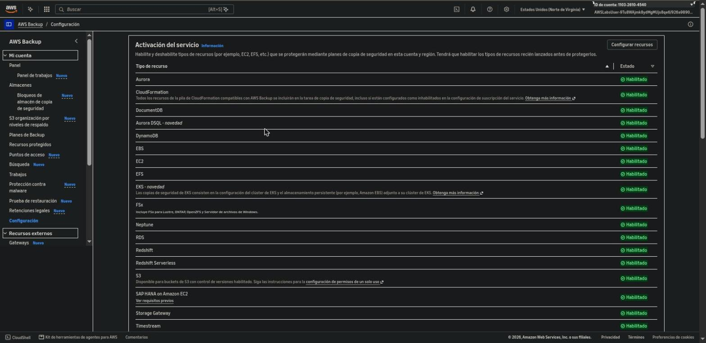

## 1.2 Crear el almacén con cifrado

En Almacenes > Crear un nuevo almacén puse el nombre `Lab-Backup-Vault`, tipo *Almacén de copia de seguridad* y como clave de cifrado la de AWS por defecto, `aws/backup`. Al elegirla aparece su ID y que está habilitada.

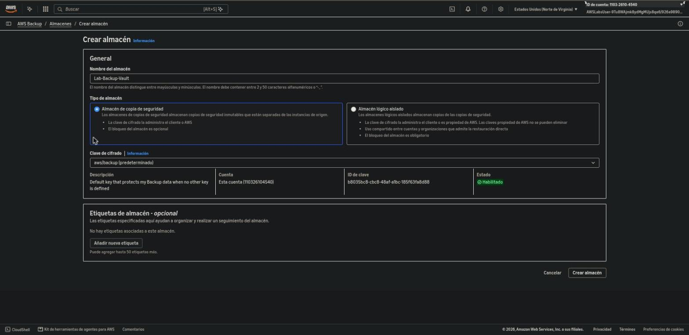

Al crearlo sale el aviso verde y en el resumen se ve el ARN del almacén y el ID de la clave KMS con la que se cifran los puntos de recuperación. De momento no tiene ninguno.

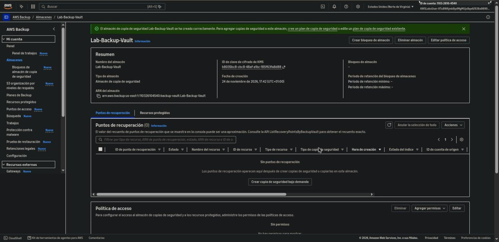

# Tarea 2. Copias bajo demanda

## 2.1 Copia de la instancia EC2

Desde el propio almacén, con el botón *Crear copia de seguridad bajo demanda*, configuré la copia de la instancia:

- Tipo de recurso: EC2, y la instancia `i-04587052f403e3c01` (`Lab1-EC2`).
- Crear copia de seguridad ahora.
- Retención total: 3 días. La consola avisa de que recomienda al menos 7 días, pero el laboratorio pide 3.
- Almacén: `Lab-Backup-Vault`.

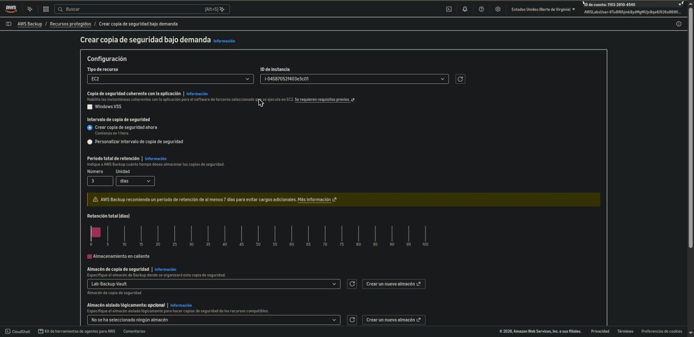

En el rol de IAM hay que marcar *Usar otro rol* y elegir `AWSBackupWorkshopRole` en vez del rol por defecto.

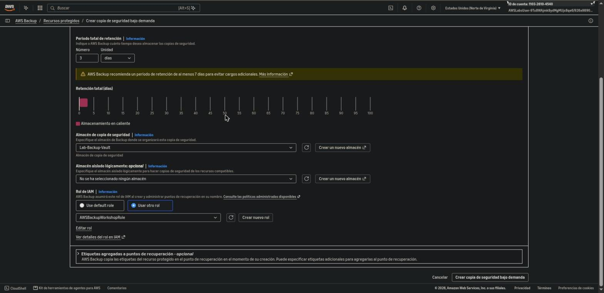

Al darle a crear te lleva a Trabajos, donde aparece el trabajo de la EC2 en estado *Creado*.

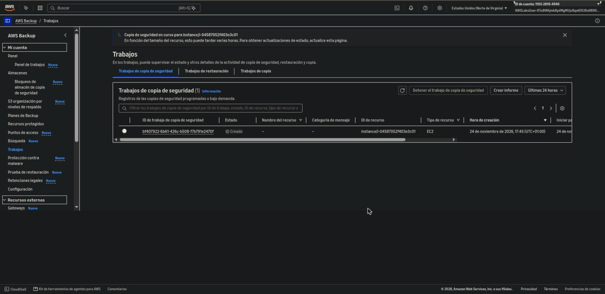

## 2.2 Copia del EFS y de la base de datos RDS

Repetí lo mismo para el EFS: tipo EFS, el sistema de archivos `fs-0cdf6b5be507f78c2` (`Lab1-EFS`), 3 días, `Lab-Backup-Vault` y `AWSBackupWorkshopRole`. En EFS aparece además la opción de pasar las copias a almacenamiento en frío, que dejé sin marcar.

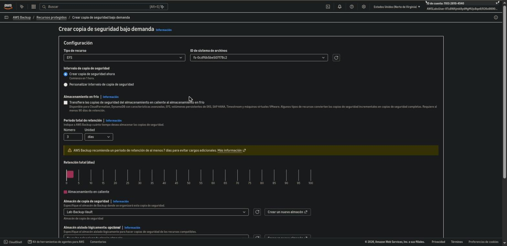

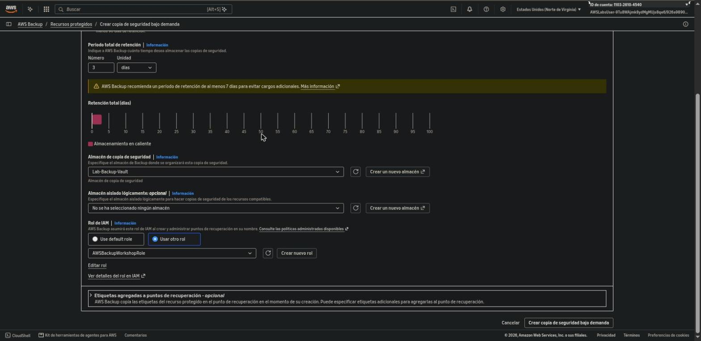

En la lista de trabajos ya se ve el del EFS creado y el de la EC2 en ejecución.

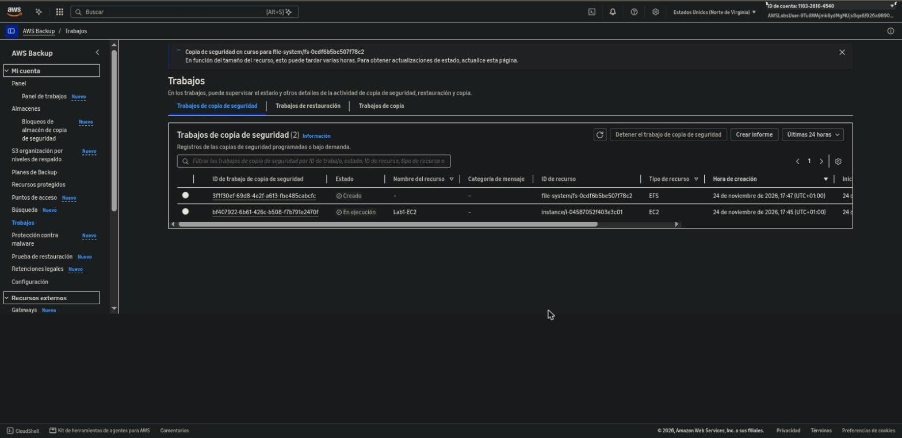

Y lo mismo para RDS con la base de datos `lab1-rds`:

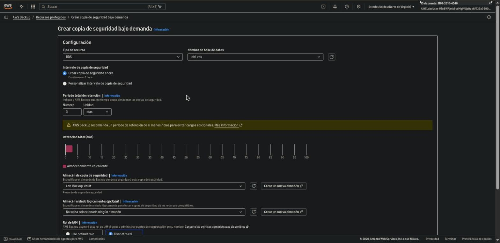

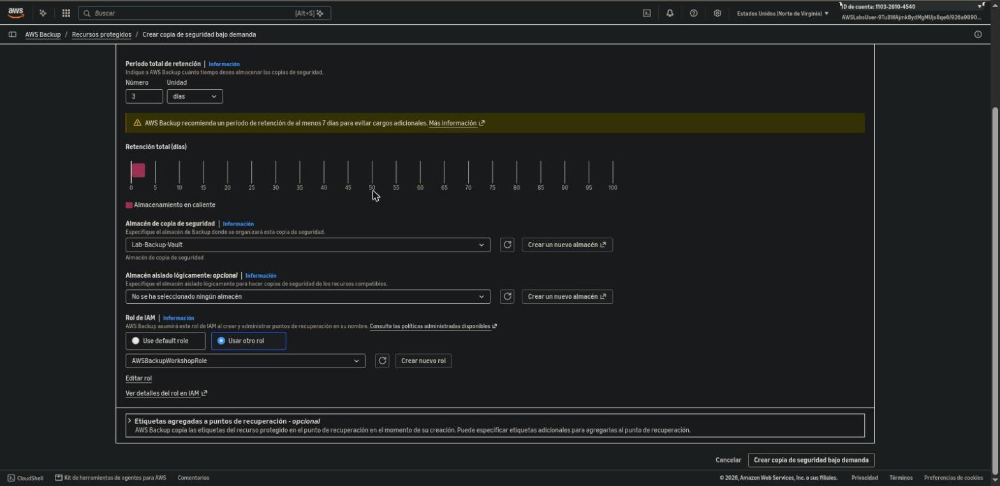

Cuando lancé la de RDS, las de EC2 y EFS ya habían terminado:

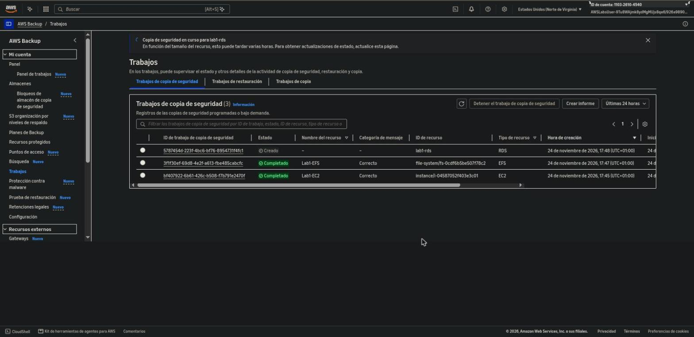

Al cabo de unos minutos los tres trabajos estaban en *Completado* con la categoría de mensaje *Correcto*.

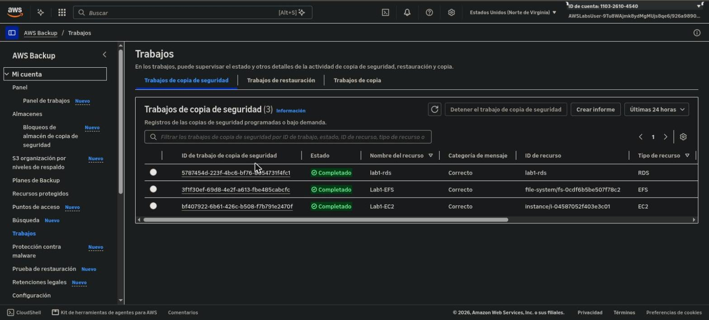

En el almacén se ven los tres puntos de recuperación. Lo curioso es que cada servicio guarda la copia de una forma distinta: la EC2 queda como una AMI (`image/ami-...`), el EFS como una copia de seguridad propia de AWS Backup y la RDS como una instantánea de la base de datos.

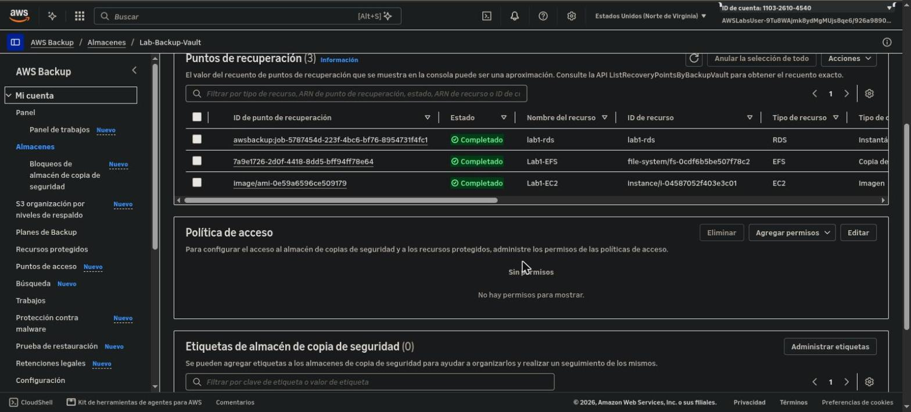

# Tarea 3. Plan de copias cada hora

En Planes de Backup > Crear plan de copia de seguridad elegí *Crear un nuevo plan* y lo llamé `HourlyBackupPlan-Lab1`. La primera regla se llama `HourlyBackupRule`, guarda en `Lab-Backup-Vault` y tiene frecuencia *Por hora*.

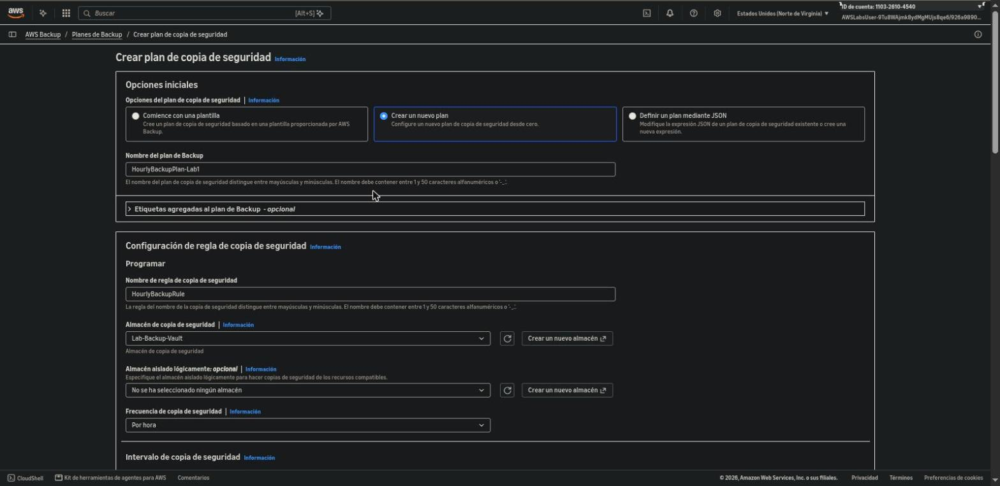

En el intervalo de la copia puse como hora de inicio las 17:57, unos 5 minutos después de la hora a la que lo estaba configurando, con la zona horaria Europe/Madrid (UTC+01:00). *Comenzar dentro de* 1 hora y *Completar en* 2 horas: el trabajo puede empezar en la hora siguiente a la programada y tiene que acabar en 2 horas. La consola avisa de que con frecuencia por hora y empezando a las 17:57 habrá 7 copias al día, de 17:57 a 23:57.

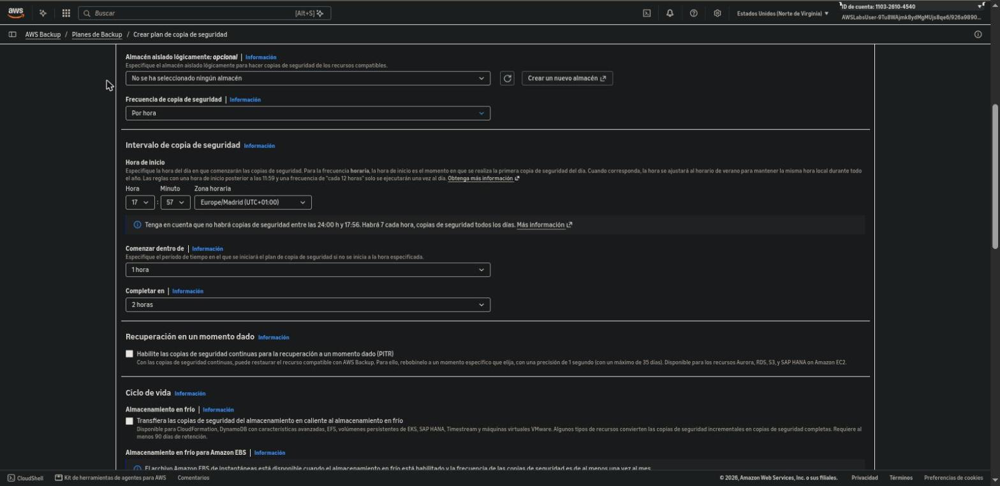

En el ciclo de vida dejé sin marcar el almacenamiento en frío y puse 3 días de retención total.

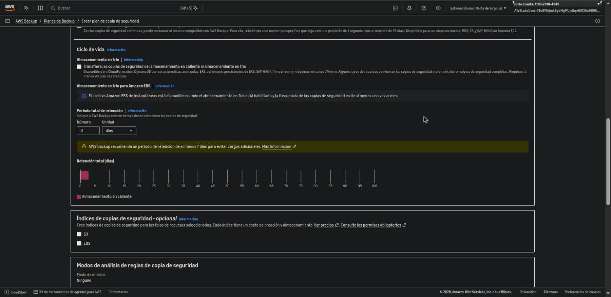

Al crear el plan pasa directamente a *Asignar recursos*. Puse como nombre `HourlyPlanResourceAssignment`, el rol `AWSBackupWorkshopRole`, *Incluir todos los tipos de recursos* y filtré con la etiqueta `backup` *Igual a* `hourly`. Así el plan solo copia los recursos que lleven esa etiqueta, sean del tipo que sean.

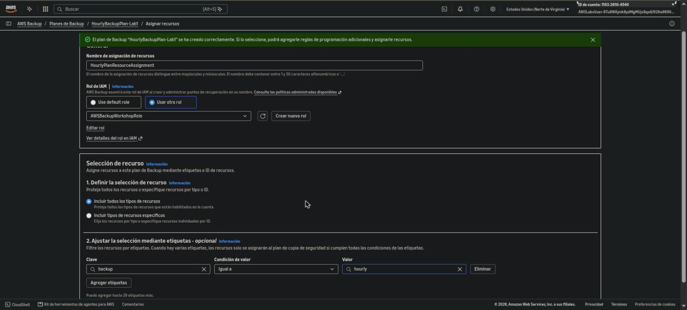

Al asignar sale un aviso de que incluir todos los tipos de recursos puede hacer copias de muchos recursos y tener costes, que acepté con *Continuar*. En el plan quedan la regla y la asignación de recursos.

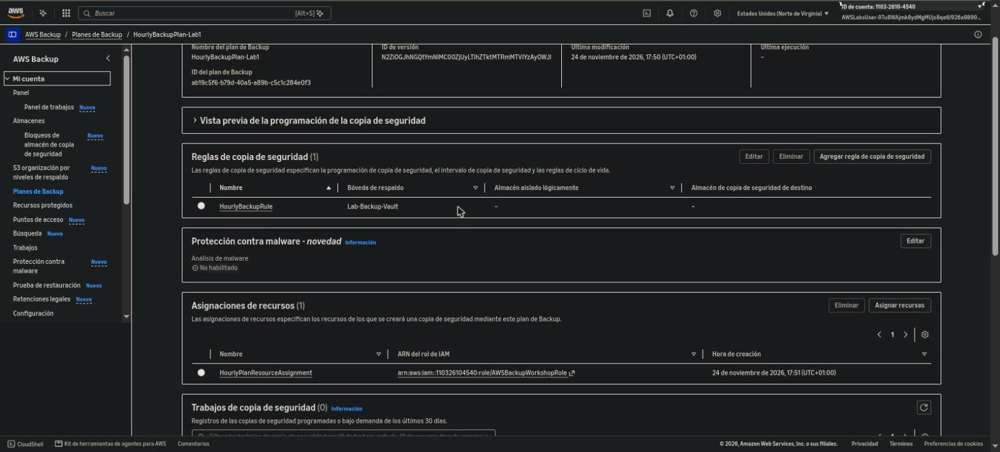

# Tarea 4. Etiquetas en los recursos

Para que el plan encuentre los recursos hay que ponerles la etiqueta. Los tres ya venían con las etiquetas `BackupEnabled`, `Environment` y `Name`, y les añadí `backup = hourly`.

En la EC2 desde Instancias > `Lab1-EC2` > Etiquetas > Administrar etiquetas:

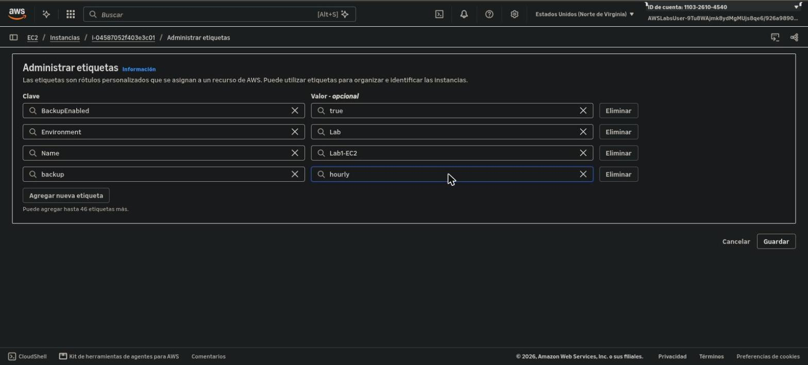

En el EFS desde el sistema de archivos > Etiquetas > Administrar etiquetas:

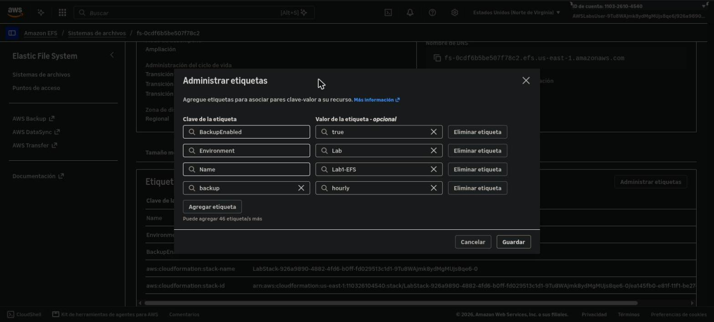

Y en RDS desde la base de datos `lab1-rds` > Etiquetas > Administrar etiquetas, y *Guardar cambios*:

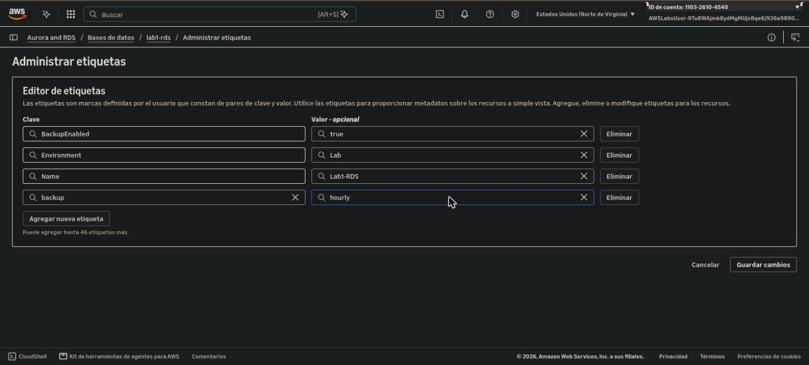

## Comprobación del plan

En el detalle del plan, la *Vista previa de la programación* muestra las 10 próximas ejecuciones: la primera a las 17:57 y después cada hora hasta las 23:57, y al día siguiente vuelve a empezar a las 17:57.

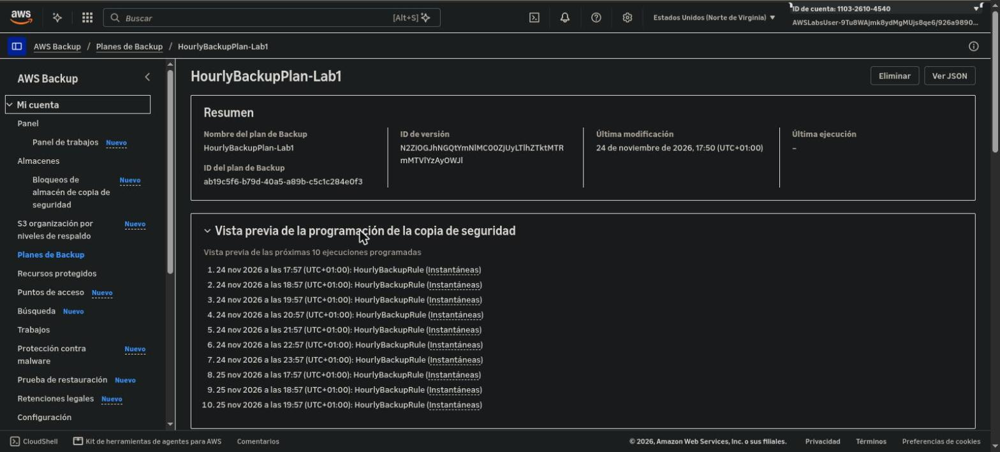

En *Trabajos* es donde van apareciendo los trabajos que lanza el plan. Con *Comenzar dentro de 1 hora*, AWS Backup puede empezar la primera copia en cualquier momento entre las 17:57 y las 18:57, así que no sale justo a la hora programada. Al terminar, el validador del laboratorio marcaba las tareas como correctas (100 %).

# Conclusiones

Lo que más me ha gustado de AWS Backup es que con un solo plan se cubren a la vez la EC2, el EFS y la RDS, aunque cada servicio guarde la copia a su manera (AMI, copia de EFS e instantánea de RDS). Usar una etiqueta para elegir los recursos también es muy práctico: si mañana se crea otro servidor, basta con ponerle `backup = hourly` para que entre en el plan sin tocar nada más.

También he visto la diferencia entre las copias bajo demanda, que se lanzan a mano por ejemplo antes de un cambio importante, y las del plan, que se hacen solas según el horario y se borran cuando pasa la retención. Con una retención de solo 3 días la consola avisa de que puede haber cargos adicionales, porque recomienda guardar las copias al menos 7 días.
