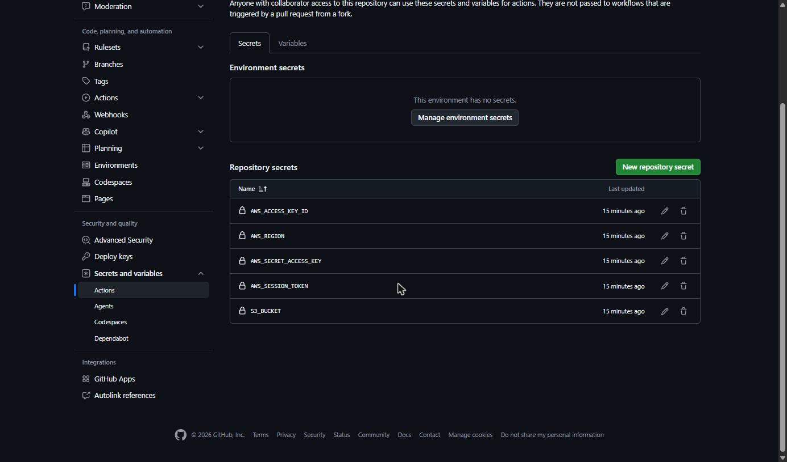
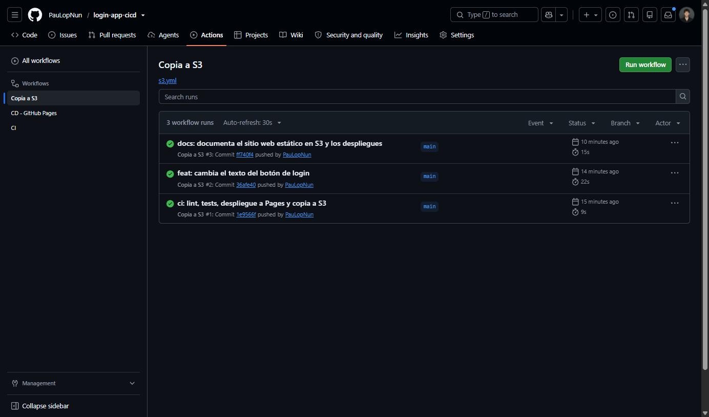
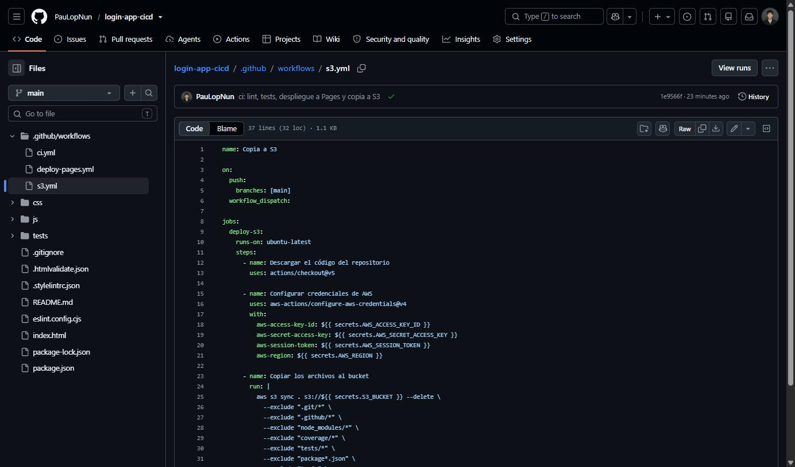
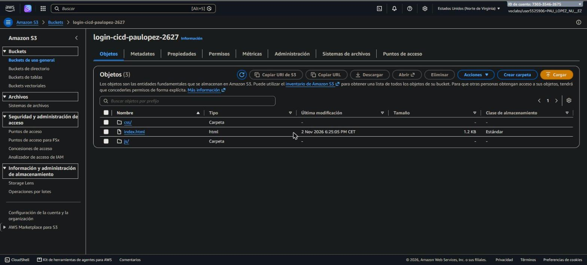
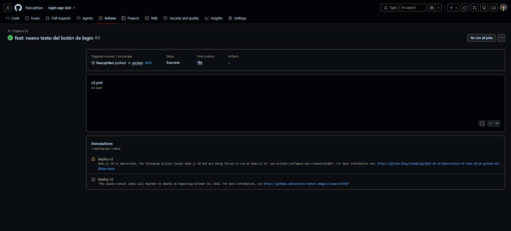
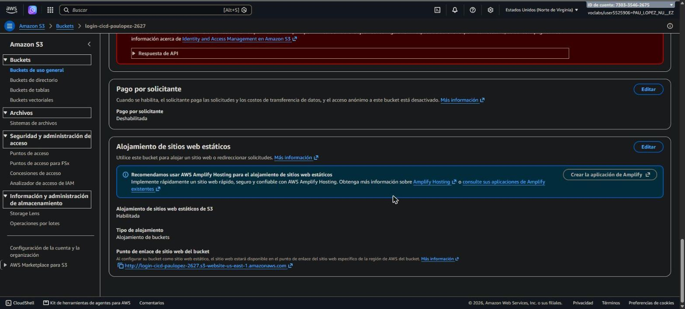
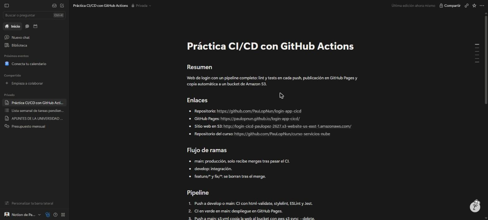
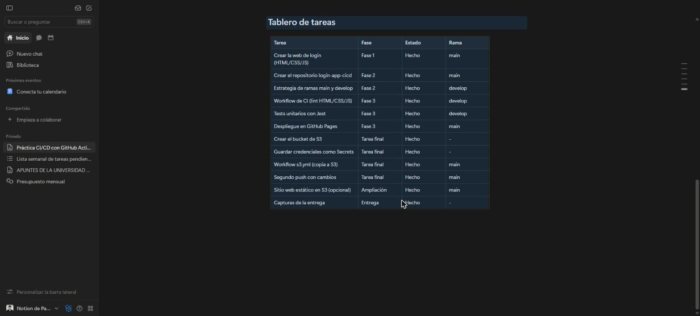

# Evidencias de ejecución

Datos reales obtenidos el 2026-11-02 del repositorio [login-app-cicd](https://github.com/PauLopNun/login-app-cicd). Las capturas de pantalla de la entrega (consola de S3, Secrets y pestaña Actions) se sacan de las consolas web; este documento recoge los mismos datos en texto.

## Ejecuciones de los workflows

```
CD - GitHub Pages  main     success  CD - GitHub Pages
CI                 main     success  docs: documenta el sitio web estático en S3 y los despliegues
Copia a S3         main     success  docs: documenta el sitio web estático en S3 y los despliegues
CI                 develop  success  docs: documenta el sitio web estático en S3 y los despliegues
CD - GitHub Pages  main     success  CD - GitHub Pages
CI                 main     success  feat: cambia el texto del botón de login
Copia a S3         main     success  feat: cambia el texto del botón de login
CI                 develop  success  feat: cambia el texto del botón de login
CD - GitHub Pages  main     success  CD - GitHub Pages
CI                 main     success  ci: lint, tests, despliegue a Pages y copia a S3
Copia a S3         main     success  ci: lint, tests, despliegue a Pages y copia a S3
CI                 develop  success  ci: lint, tests, despliegue a Pages y copia a S3
```

## Secrets configurados (solo nombres)

```
AWS_ACCESS_KEY_ID
AWS_REGION
AWS_SECRET_ACCESS_KEY
AWS_SESSION_TOKEN
S3_BUCKET
```

## Ramas

```
  origin/develop
  origin/main
```

## Commits

```
ff740f4 docs: documenta el sitio web estático en S3 y los despliegues
36afe40 feat: cambia el texto del botón de login
1e9566f ci: lint, tests, despliegue a Pages y copia a S3
b68196b proyecto inicial
```

## Contenido del bucket tras el último push

```
2026-11-02 18:25:05       1294 css/style.css
2026-11-02 18:25:05       1223 index.html
2026-11-02 18:25:05       1228 js/app.js
```

Antes del segundo push `index.html` pesaba 1222 bytes (botón «Entrar»); después, 1223 bytes (botón «Acceder»).

## Webs publicadas

- GitHub Pages: https://paulopnun.github.io/login-app-cicd/
- Sitio web estático de S3: http://login-cicd-paulopez-2627.s3-website-us-east-1.amazonaws.com/

## Tercer push (antes y después en la consola de S3)

Para tener un «antes» y un «después» reales se hizo un tercer push que cambia el texto del botón a «Iniciar sesión». En la consola de S3, `index.html` pasó de la última modificación `2 Nov 2026 6:25:05 PM CET` a `2 Nov 2026 6:36:39 PM CET`. La ejecución #4 de «Copia a S3» terminó en verde en 18 s.

## Capturas

| Entregable | Captura |
|:--|:--|
| Secrets de GitHub (solo nombres) |  |
| Workflow «Copia a S3» en la pestaña Actions |  |
| Archivo `s3.yml` |  |
| Bucket antes del segundo push con cambios |  |
| Bucket después |  |
| Ejecución correcta (#4) |  |
| Alojamiento web estático del bucket (ampliación T.6) |  |

## Documentación y tareas en Notion

La página «Práctica CI/CD con GitHub Actions» está creada en Notion (espacio privado) con el resumen, los enlaces, el flujo de ramas, el pipeline, la nota de seguridad y un tablero con las 12 tareas. Los ficheros de [`notion/`](../notion) son el origen de ese contenido.

| Página de Notion | Tablero de tareas |
|:--|:--|
|  |  |
