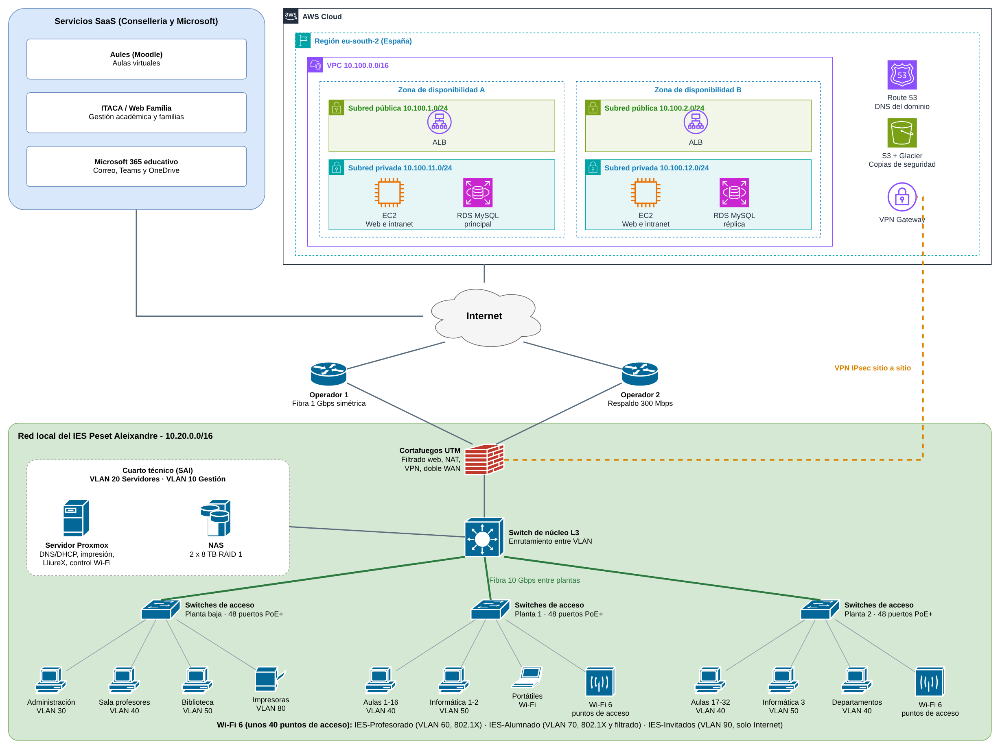

# Tarea 1.2 - TI en instituto

## Objetivo

Diseñar la infraestructura TI del nuevo IES Peset Aleixandre (32 unidades, unos 1.000 alumnos y 100 docentes): estimar servicios y recursos, elegir la modalidad de despliegue y dibujar la red.

## Propuesta

| Apartado | Resumen |
|:--|:--|
| Modalidad | Híbrida: red y servicios locales en el centro, web, intranet y copias en AWS |
| SaaS | Aules, ITACA, Web Família y Microsoft 365 (Conselleria) |
| Local | Cortafuegos UTM con doble WAN, switch de núcleo L3, servidor Proxmox, NAS en RAID 1, unos 40 AP Wi-Fi 6 |
| AWS (eu-south-2) | VPC en dos zonas, ALB, EC2 con Auto Scaling, RDS Multi-AZ, S3 + Glacier, Route 53, VPN IPsec |
| Direccionamiento | 10.20.0.0/16 en el centro con 9 VLAN, 10.100.0.0/16 en AWS |

  

## Entrega

- [`entrega/fci_t1.2_lopez_nunez.docx`](entrega/fci_t1.2_lopez_nunez.docx)
- Diagrama hecho con draw.io: [`capturas/01-diagrama-red.drawio`](capturas/01-diagrama-red.drawio) (editable en [app.diagrams.net](https://app.diagrams.net))

---

[Volver a la asignatura](../README.md)
