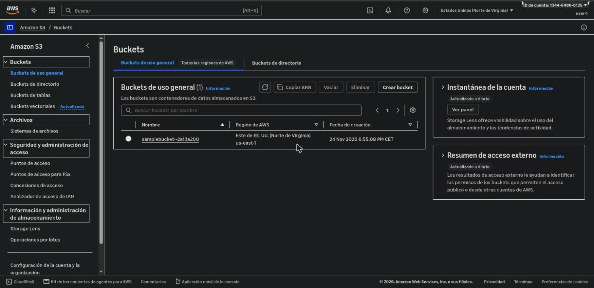
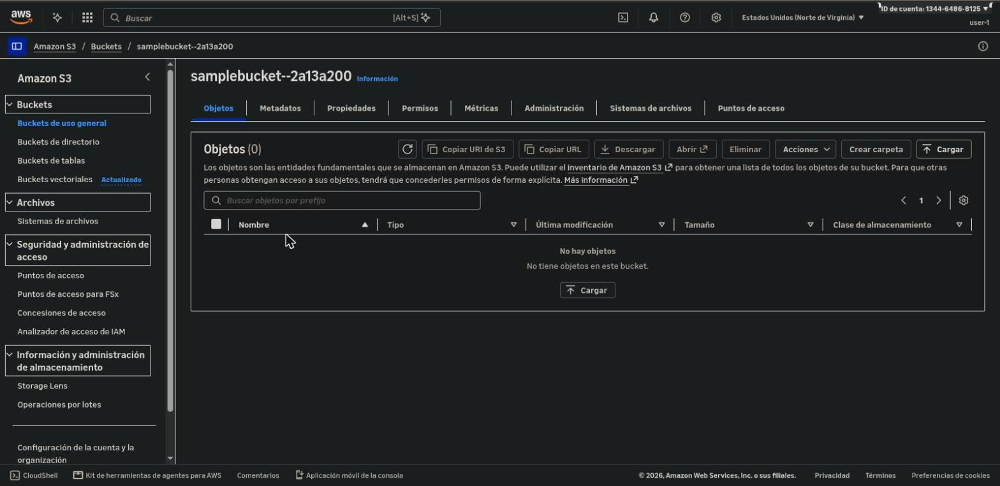
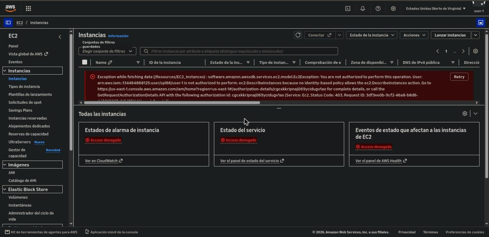
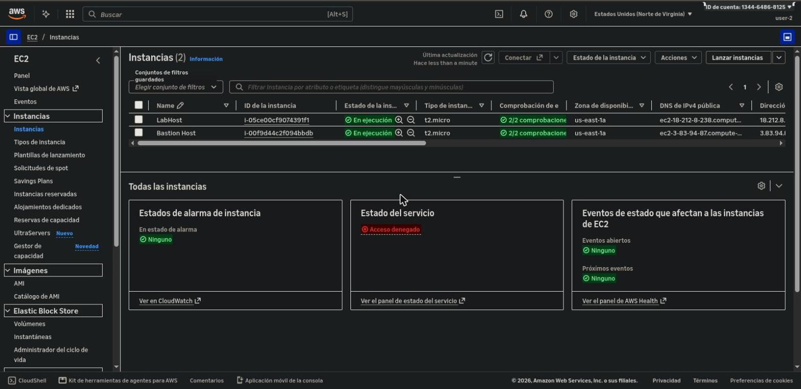
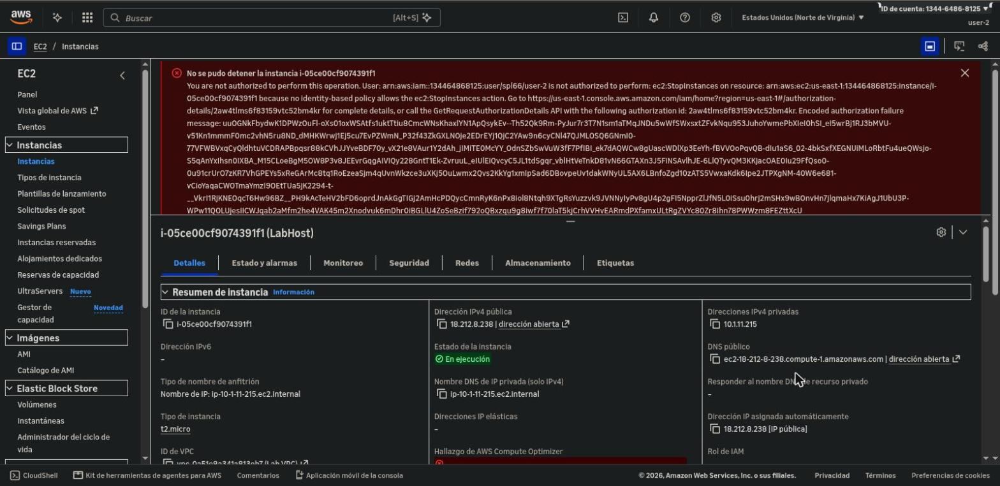
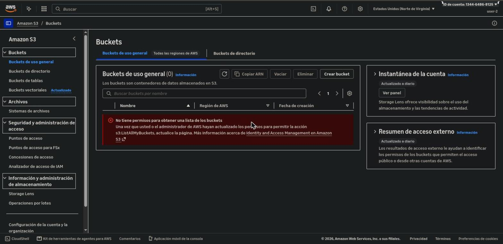
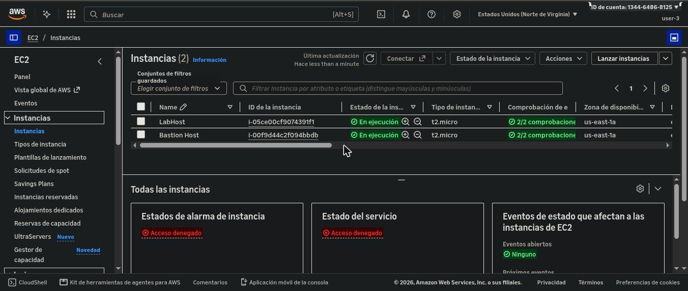
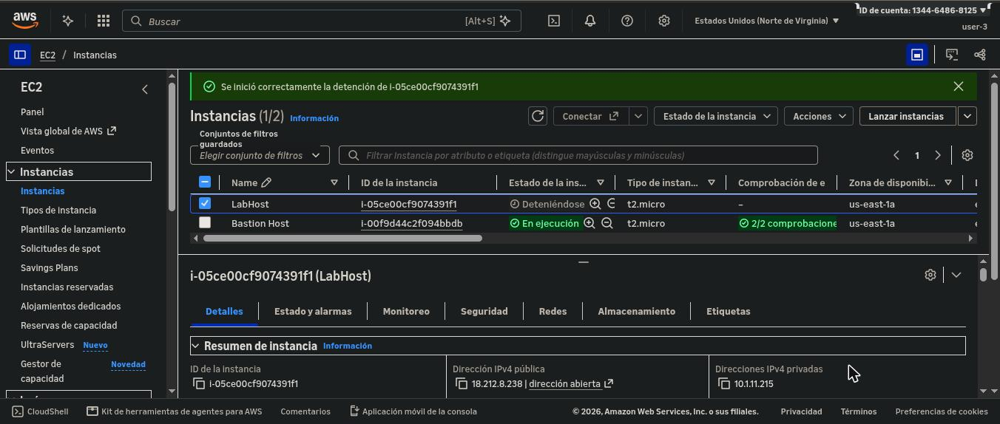

Laboratorio de AWS Academy *Lab 1: Introduction to AWS IAM*, para la asignatura de Fundamentos y configuración inicial de servicios en la nube.

# Introducción

IAM es el servicio de AWS que controla **quién** puede entrar en la cuenta y **qué** puede hacer. En este laboratorio ya venían creados tres usuarios (`user-1`, `user-2` y `user-3`) y tres grupos (`EC2-Admin`, `EC2-Support` y `S3-Support`), cada uno con una política distinta. Lo que hay que hacer es meter a cada usuario en su grupo según su puesto de trabajo y comprobar que solo puede hacer lo que le toca.

Las tareas 1 y 2 las he hecho con la AWS CLI usando las credenciales del laboratorio, y la tarea 3 en la consola iniciando sesión con cada usuario.

# Tarea 1. Explorar usuarios y grupos

Primero miré los usuarios. Los tres tienen contraseña de consola (perfil de inicio de sesión), pero no están en ningún grupo ni tienen políticas, así que ahora mismo no pueden hacer nada.

```
$ aws iam list-users --query 'Users[].[UserName,CreateDate]' --output table
|  awsstudent |  2026-11-24T17:55:42+00:00  |
|  user-1     |  2026-11-24T17:55:06+00:00  |
|  user-2     |  2026-11-24T17:55:06+00:00  |
|  user-3     |  2026-11-24T17:55:06+00:00  |

$ aws iam list-groups-for-user --user-name user-1 --query 'Groups[].GroupName' --output text
(vacío: no está en ningún grupo)

$ aws iam get-login-profile --user-name user-1 --query 'LoginProfile.[UserName,CreateDate]' --output text
user-1	2026-11-24T17:55:42+00:00
```

Después los grupos y sus políticas:

```
$ aws iam list-groups --query 'Groups[].GroupName' --output table
|  EC2-Admin    |
|  EC2-Support  |
|  S3-Support   |

$ aws iam list-attached-group-policies --group-name EC2-Support
AmazonEC2ReadOnlyAccess   (política administrada)

$ aws iam list-attached-group-policies --group-name S3-Support
AmazonS3ReadOnlyAccess    (política administrada)

$ aws iam list-group-policies --group-name EC2-Admin
EC2-Admin-Policy          (política insertada / inline)
```

Hay dos tipos de políticas:

- **Administradas** (`AmazonEC2ReadOnlyAccess` y `AmazonS3ReadOnlyAccess`): las mantiene AWS y se pueden asignar a muchos usuarios y grupos. Si cambian, el cambio se aplica a todos a la vez.
- **Insertadas o inline** (`EC2-Admin-Policy`): pertenecen solo a ese grupo. Se usan para casos puntuales.

Cada política tiene sentencias con tres partes: **Effect** (Allow o Deny), **Action** (las llamadas a la API que se permiten) y **Resource** (sobre qué recursos; `*` es cualquiera). Estas son las tres:

| Grupo | Política | Qué permite |
|:--|:--|:--|
| EC2-Support | `AmazonEC2ReadOnlyAccess` | `ec2:Describe*` y ver ELB, CloudWatch y Auto Scaling: solo mirar EC2 |
| S3-Support | `AmazonS3ReadOnlyAccess` | `s3:Get*`, `s3:List*` y `s3:Describe*`: solo mirar S3 |
| EC2-Admin | `EC2-Admin-Policy` | `ec2:Describe*`, `ec2:StartInstances` y `ec2:StopInstances`: ver, arrancar y parar instancias |

```
$ aws iam get-group-policy --group-name EC2-Admin --policy-name EC2-Admin-Policy --query PolicyDocument
{
    "Version": "2012-10-17",
    "Statement": [
        {
            "Action": ["ec2:Describe*", "ec2:StartInstances", "ec2:StopInstances"],
            "Resource": ["*"],
            "Effect": "Allow"
        }
    ]
}
```

# Tarea 2. Añadir los usuarios a los grupos

Según el escenario de la empresa, cada persona va al grupo de su puesto:

| Usuario | Grupo | Permisos |
|:--|:--|:--|
| user-1 | S3-Support | Solo lectura en S3 |
| user-2 | EC2-Support | Solo lectura en EC2 |
| user-3 | EC2-Admin | Ver, arrancar y parar instancias EC2 |

```
$ aws iam add-user-to-group --group-name S3-Support --user-name user-1
$ aws iam add-user-to-group --group-name EC2-Support --user-name user-2
$ aws iam add-user-to-group --group-name EC2-Admin --user-name user-3

$ aws iam get-group --group-name S3-Support --query '[Group.GroupName, length(Users), Users[].UserName]' --output text
S3-Support	1
user-1
$ aws iam get-group --group-name EC2-Support ...
EC2-Support	1
user-2
$ aws iam get-group --group-name EC2-Admin ...
EC2-Admin	1
user-3
```

Cada grupo tiene ahora 1 usuario. Los usuarios no tienen permisos propios: los **heredan del grupo**. Así, si mañana entra otra persona de soporte de S3, basta con meterla en `S3-Support`.

Antes de probarlo en la consola, comprobé con el simulador de políticas de IAM qué podría hacer cada usuario:

```
$ aws iam simulate-principal-policy --policy-source-arn arn:aws:iam::134464868125:user/user-1 \
    --action-names s3:ListAllMyBuckets ec2:DescribeInstances ec2:StopInstances
```

| Acción | user-1 | user-2 | user-3 |
|:--|:-:|:-:|:-:|
| `s3:ListAllMyBuckets` | allowed | implicitDeny | implicitDeny |
| `ec2:DescribeInstances` | implicitDeny | allowed | allowed |
| `ec2:StopInstances` | implicitDeny | implicitDeny | allowed |

*implicitDeny* significa que ninguna política lo permite, y en IAM todo lo que no está permitido expresamente está denegado.

# Tarea 3. Iniciar sesión y probar los usuarios

En el panel de IAM está la URL de inicio de sesión para los usuarios IAM de la cuenta: `https://134464868125.signin.aws.amazon.com/console`. Entré con cada usuario (las contraseñas son las del laboratorio) y cerré sesión entre uno y otro.

## user-1 (soporte de S3)

En S3 ve el bucket de la cuenta y puede entrar a ver su contenido, que está vacío:





En cambio, en EC2 > Instancias le sale *You are not authorized to perform this operation*, porque no tiene ningún permiso de EC2 (`ec2:DescribeInstances`):



## user-2 (soporte de EC2)

Ve las instancias, entre ellas **LabHost**, porque tiene `AmazonEC2ReadOnlyAccess`:



Seleccioné LabHost y le di a Estado de la instancia > Detener instancia > Detener. Falla con *You are not authorized to perform: ec2:StopInstances* y la instancia sigue en ejecución: puede mirar, pero no cambiar nada.



En S3 le sale *No tiene permisos para obtener una lista de los buckets* (`s3:ListAllMyBuckets`):



## user-3 (administrador de EC2)

También ve las instancias:



Y esta vez, al detener LabHost, sale *Se inició correctamente la detención* y la instancia pasa a *Deteniéndose*, porque su política inline incluye `ec2:StopInstances`:



Lo comprobé después con la CLI:

```
$ aws ec2 describe-instances --instance-ids i-05ce00cf9074391f1 \
    --query "Reservations[].Instances[].[InstanceId,State.Name,StateTransitionReason]" --output table
|  i-05ce00cf9074391f1 |  stopped |  User initiated (2026-11-24 18:22:03 GMT)  |
```

# Conclusiones

- Los permisos se dan mejor a **grupos** que a usuarios sueltos: el usuario hereda lo que tenga su grupo y es mucho más fácil de mantener.
- En IAM todo está **denegado por defecto**. Cada usuario solo pudo hacer justo lo que su política permite: user-1 solo S3, user-2 ver EC2 y user-3 ver y parar EC2.
- Esto es el **principio de mínimo privilegio**: a cada persona solo lo que necesita para su trabajo. Por ejemplo, el de soporte puede mirar las instancias pero no apagarlas por error.
- Las políticas **administradas** sirven para permisos comunes y las **inline** para casos concretos de un solo grupo o usuario.
- Los usuarios IAM entran por la URL de inicio de sesión de la cuenta, con el ID de la cuenta, su nombre de usuario y su contraseña.
