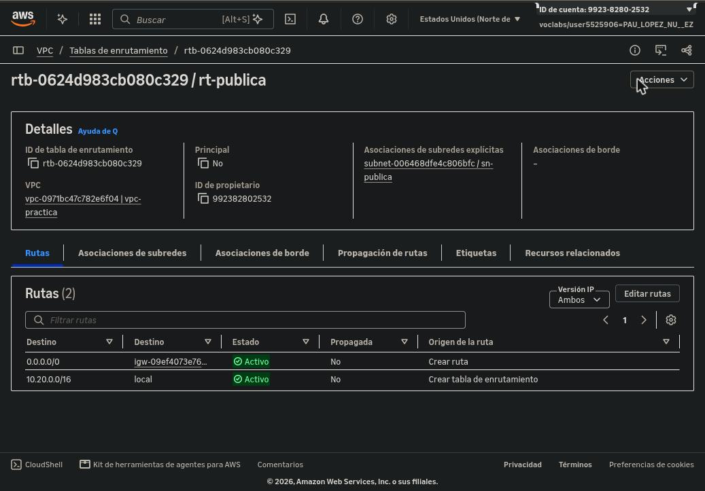
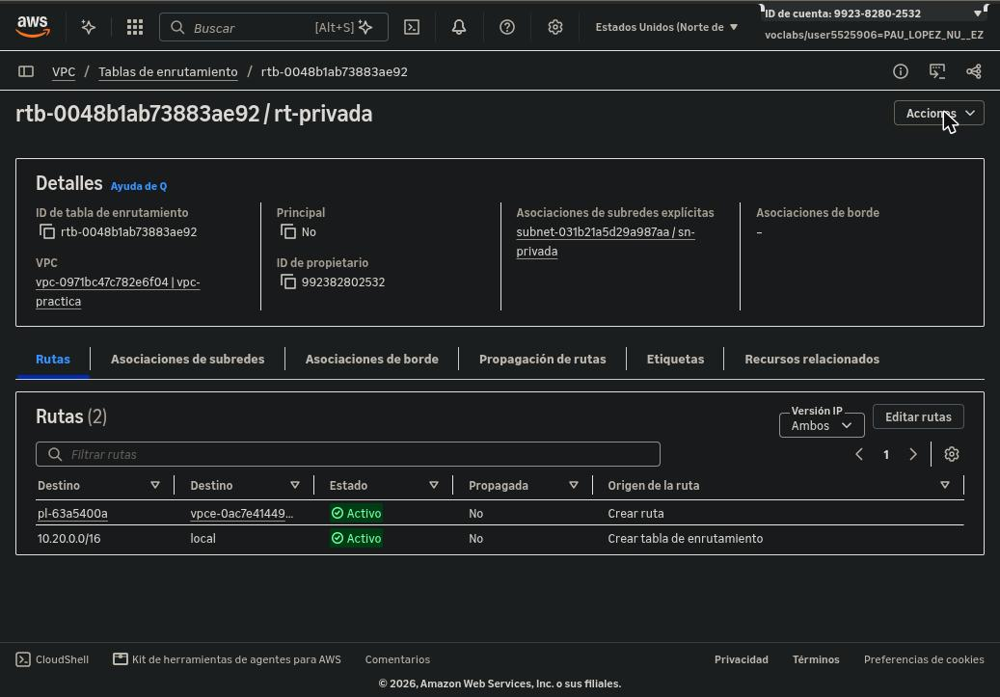
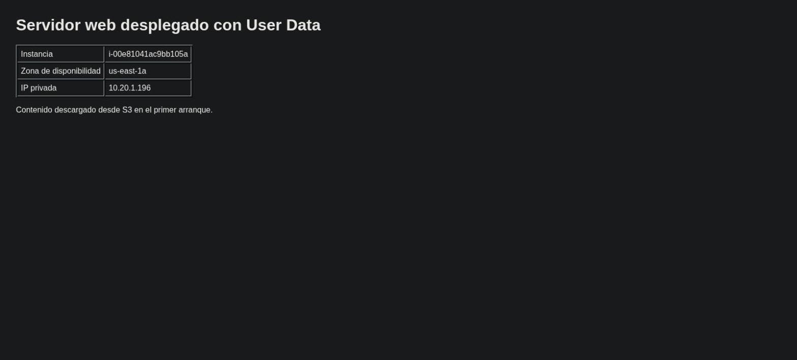
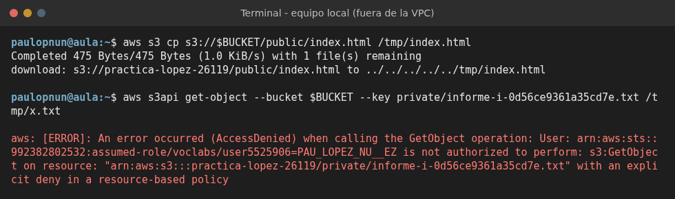
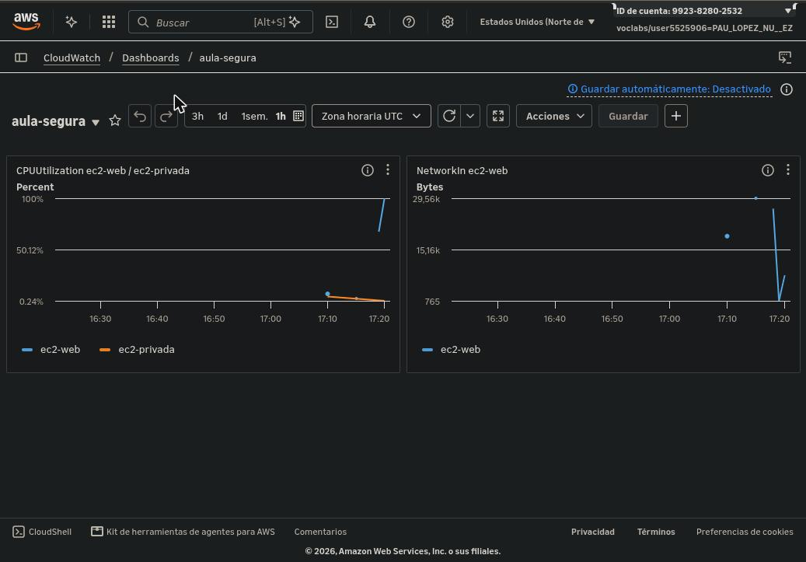
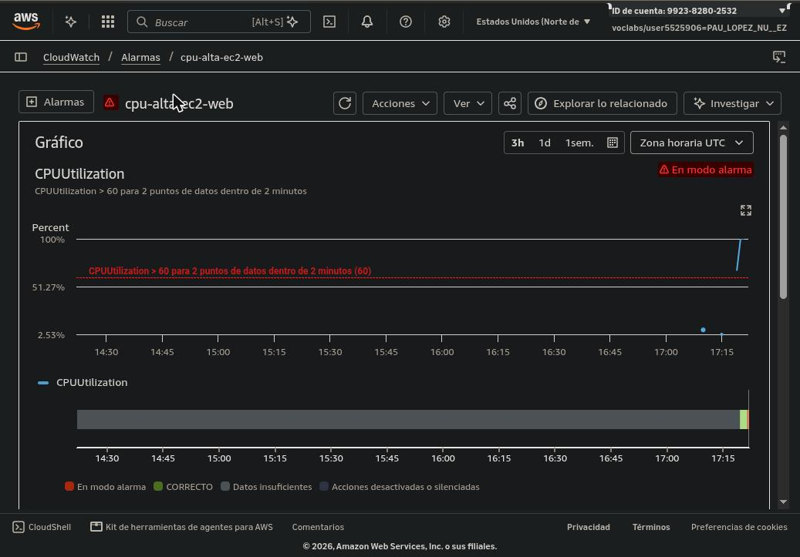

Esta guía explica con palabras sencillas qué he montado en la práctica, en qué orden y por qué cada pieza está ahí. Los comandos completos y todas las capturas están en la memoria; aquí está la idea de cada paso.

# La idea en una frase

Un **servidor web** al que puede entrar cualquiera desde Internet, y detrás un **servidor privado** que no tiene Internet pero que sí puede guardar y leer ficheros en un **bucket de S3** por un camino interno de AWS. Así, aunque alguien atacara la web, el servidor privado y sus datos quedan aislados.

Es lo que se llama una **DMZ** (zona desmilitarizada): la parte expuesta (la web) está separada de la parte que se protege (el backend).

# El esquema

```
               Internet
                   |
            [ igw-practica ]   (puerta a Internet)
                   |
+------------ vpc-practica 10.20.0.0/16 -----------+
|                                                  |
| sn-publica 10.20.1.0/24   sn-privada 10.20.2.0/24|
| rt-publica:               rt-privada:            |
|  0.0.0.0/0 -> IGW          solo local + S3       |
|                                                  |
|  +---------+  SSH/ping   +-------------+         |
|  | ec2-web | ----------> | ec2-privada |         |
|  | Apache  |             | sin Internet|         |
|  +---------+             +------+------+         |
|                                 |                |
|                           [ vpce-s3 ] endpoint   |
+---------------------------------|----------------+
                                  |
                 S3: practica-lopez-26119
                 public/index.html
                 private/informe-<ID>.txt
```

# Paso 0. Preparar el entorno

- Arranqué el Learner Lab (región us-east-1) y copié las credenciales de *AWS Details* en `~/.aws/credentials` para poder usar la AWS CLI desde mi equipo. Lo comprobé con `aws sts get-caller-identity`.
- Preparé el `index.html` del guion. Tiene huecos (`__ID__`, `__AZ__`, `__IP__`) que luego el servidor rellena con sus propios datos.

# Paso 1. La red (por consola)

**Qué hice:**

1. **VPC** `vpc-practica` con el rango `10.20.0.0/16`. Es mi red privada dentro de AWS.
2. Dos **subredes** dentro de la VPC:
   - `sn-publica` (`10.20.1.0/24`), con IP pública automática para lo que se lance en ella.
   - `sn-privada` (`10.20.2.0/24`), sin IP pública.
3. **Internet Gateway** `igw-practica` conectado a la VPC. Sin él, nada de la VPC podría salir a Internet.
4. Dos **tablas de rutas**:
   - `rt-publica`: además de la ruta local, `0.0.0.0/0` hacia el IGW. Esta es la ruta que hace "pública" a una subred.
   - `rt-privada`: solo la ruta local. Como no tiene ruta al IGW, la subred privada no puede salir a Internet.
5. Dos **grupos de seguridad** (el cortafuegos de cada instancia):
   - `sgr-web`: puerto 80 (web) abierto a todo el mundo y puerto 22 (SSH) solo desde la IP pública del aula.
   - `sgr-privada`: SSH y ping **solo si vienen de `sgr-web`**. Es decir, al servidor privado solo se llega pasando antes por el web.

**Por qué:** la diferencia entre subred pública y privada no está en la subred en sí, sino en su tabla de rutas.





# Paso 2. El bucket de S3 y el endpoint

**Qué hice:**

1. **Bucket** `practica-lopez-26119` con dos carpetas: `public/` (aquí subí el `index.html`) y `private/` (para los informes del servidor privado).
2. **VPC Endpoint de tipo Gateway** `vpce-s3`, asociado a `rt-privada`. Al hacerlo, AWS añade sola una ruta nueva en esa tabla hacia S3 (`pl-63a5400a`). Es un "atajo" interno: la subred privada llega a S3 **sin pasar por Internet**.
3. **Política del bucket** con dos reglas que deniegan:
   - `SoloTLS`: cualquier acceso que no vaya cifrado (HTTPS).
   - `PrivateSoloDesdeEndpoint`: leer o escribir en `private/` si la petición **no** viene por mi endpoint.

**Por qué:** así lo de `private/` solo se puede tocar desde dentro de la VPC, aunque alguien tenga credenciales válidas.

# Paso 3. El servidor web `ec2-web`

**Qué hice:** lancé una instancia Amazon Linux 2023 en `sn-publica`, con `sgr-web`, IMDSv2 obligatorio y el rol `LabInstanceProfile` (para que pueda leer de S3 sin poner claves dentro). En **User Data** le puse un script que se ejecuta solo en el primer arranque:

1. Instala Apache (`dnf install -y httpd`).
2. Pide un token a IMDSv2 y con él consulta sus propios metadatos: ID de instancia, zona de disponibilidad e IP privada.
3. Se descarga `public/index.html` del bucket.
4. Con `sed` cambia los huecos `__ID__`, `__AZ__` e `__IP__` por sus datos reales.
5. Arranca Apache y lo deja activado para siempre (`systemctl enable --now httpd`).

**Cómo lo comprobé:** abrí la IP pública en el navegador y salió la página con los datos de la propia instancia.



# Paso 4. El servidor privado `ec2-privada` y las pruebas

**Qué hice:** lancé `ec2-privada` por CLI en `sn-privada`, con `sgr-privada` y sin IP pública. Su User Data crea un fichero `informe-<ID>.txt` y lo sube a `private/` del bucket. Como no tiene Internet, esa subida solo puede ir por el endpoint.

**Pruebas que hice y qué demuestran:**

| Prueba | Resultado | Qué demuestra |
|:--|:--|:--|
| 1. ¿Está el informe en `private/`? | Sí, `informe-i-0d56...txt` | El servidor privado llega a S3 por el endpoint |
| 2. Entrar por SSH a `ec2-privada` saltando por `ec2-web` | Entra | Solo se llega al privado pasando por el web |
| 3. Desde `ec2-privada`, `curl https://example.com` | Falla (código 28, tiempo agotado) | No tiene Internet |
| 3b. Desde `ec2-privada`, leer `private/` | Funciona | Por el endpoint sí puede |
| 4. Desde mi PC, leer `private/` | **AccessDenied** | La política del bucket bloquea fuera del endpoint |
| 5. Ping de `ec2-web` a `ec2-privada` | Responde | `sgr-privada` permite ICMP desde `sgr-web` |



**Experimento:** quité el endpoint de `rt-privada`. La ruta a S3 desapareció y `ec2-privada` dejó de llegar a S3 (se quedaba colgado). Al volver a asociarlo, funcionó otra vez. Esto confirma que todo el acceso a S3 depende de esa ruta.

> Nota: el `labsuser.pem` que tenía guardado era de otra sesión del laboratorio, así que para el SSH usé una clave temporal enviada con EC2 Instance Connect. El salto es el mismo que con ProxyJump: primero a la IP pública de `ec2-web` y desde ahí a la IP privada de `ec2-privada`.

# Paso 5. La NACL de la subred privada

**Qué hice:** creé `nacl-privada` y la asocié a `sn-privada`. Una NACL es un cortafuegos a nivel de **subred** y, a diferencia del grupo de seguridad, **no tiene estado**: hay que permitir también el tráfico de vuelta.

| Sentido | Regla | Para qué |
|:--|:--|:--|
| Entrada 100 | TCP 22 desde `10.20.1.0/24` | SSH desde la subred pública |
| Entrada 110 | TCP 1024-65535 desde cualquier origen | Respuestas de S3 |
| Salida 100 | TCP 443 a cualquier destino | Peticiones HTTPS a S3 |
| Salida 110 | TCP 1024-65535 a `10.20.1.0/24` | Respuestas del SSH |

**Qué comprobé:**

- El SSH y S3 siguen funcionando.
- El **ping deja de funcionar**, porque la NACL no tiene ninguna regla para ICMP, aunque el grupo de seguridad lo permita. Hacen falta las dos cosas.
- Si borro la regla de entrada 110, **S3 falla pero el SSH no**: las respuestas de S3 vuelven a puertos efímeros y la NACL, al no tener estado, no las deja pasar. El SSH sigue porque entra por el 22 (regla 100).

# Paso 6. Monitorización con CloudWatch

**Qué hice:**

1. Activé la **monitorización detallada** en `ec2-web` (métricas cada minuto en vez de cada 5).
2. Creé el **dashboard** `aula-segura` con la CPU de la instancia.
3. Creé la **alarma** `cpu-alta-ec2-web`: salta si la CPU media pasa del 60 % durante 2 minutos seguidos.
4. Para probarla, entré en `ec2-web` y ejecuté `yes > /dev/null` dos veces (una por núcleo) para poner la CPU al 100 %.

**Resultado:** la alarma pasó a **ALARM** (la CPU llegó al 100 %). Al parar la carga volvió a OK.





# Paso 7. Reto: lo mismo solo con la CLI

Hice el script `reto.sh`, que con un solo comando crea una red completa y un servidor web, sin tocar la consola:

1. VPC `vpc-reto` (`10.30.0.0/16`) y una subred pública.
2. Internet Gateway y tabla de rutas con `0.0.0.0/0` hacia él.
3. Grupo de seguridad con el 80 abierto y el 22 solo desde mi IP.
4. Instancia `ec2-reto` con User Data que instala Apache.
5. Espera a que Apache responda y muestra la página.

Guarda los IDs de lo que crea en un fichero y con `./reto.sh limpiar` lo borra todo en orden inverso.

# Limpieza

Al final borré todo en el orden del guion, porque unas cosas dependen de otras (por ejemplo, no se puede borrar la VPC si aún tiene subredes): instancias, alarma y dashboard, endpoint, bucket, subredes, NACL, tablas de rutas, Internet Gateway, grupos de seguridad y por último la VPC.

# Lo que he aprendido

- Una subred es pública o privada según su **tabla de rutas**, no por su nombre.
- El **VPC Endpoint** permite usar S3 desde una subred sin Internet, y la política del bucket puede exigir que se use.
- El **grupo de seguridad** tiene estado (si dejas entrar, la respuesta sale sola); la **NACL** no, y hay que abrir los dos sentidos.
- El **User Data** sirve para que un servidor se configure solo al arrancar, y con **IMDSv2** la instancia puede saber sus propios datos.
- Con **CloudWatch** puedo vigilar la CPU y que me avise cuando algo va mal.
- Todo lo que se hace por consola se puede automatizar con la **CLI** en un script, que además se puede repetir y deshacer.
